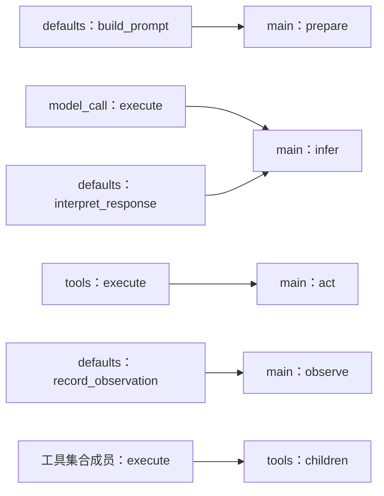
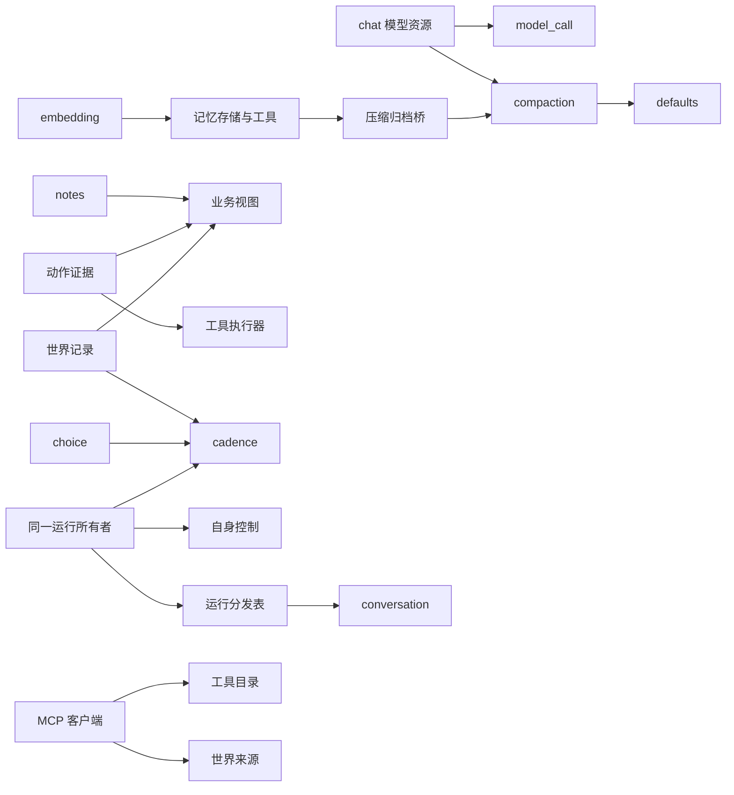

# AuroraBot 当前架构

核对基线：W08（2026-11-27）。文件名保留以维持引用；旧设计见[历史归档](archive/2026-11-09/aurorabot-design-v0.2.3.md)。本页说明职责、关系和公开行为；具体定义以[插件清单目录](aurorabot-id-catalog-v0.2.3.md)为准。

Aurora 以公共 ID、共享 ctx 和显式实例连接组织能力。插件描述并导出自己的插头、插槽和资源；宿主选择实例及连接。插件可以调用自己的槽、维护负责的 ctx 或订阅关注的 ctx，无需知道自己的插头运行时会被接到哪里。

## package、插件和宿主

| 层次 | 决定什么 | 不决定什么 |
| --- | --- | --- |
| package | 代码与依赖如何安装、按哪些 extra 分发 | 哪些插件被启用 |
| 插件 | 提供哪些公开定义、组件端口、状态与资源角色 | 应用创建多少实例、接到谁 |
| 组件实例 | 具体的方法、执行端口、自有任务和资源 | 其他组件的实现或资源所有权 |
| 宿主装配 | 插件选择、实例、地址绑定、资源引用、生命周期依赖与连接 | ReAct、控制算法或业务决策 |

一个 package 可以分发多个插件，启用一个插件也不等于创建它的全部组件。`requires` 只要求相关插件已被显式选中，不自动安装、启用、创建或连接。

| 包 | 职责与依赖边界 |
| --- | --- |
| aurora_core | ID、登记、ctx、订阅、连接、调用、生命周期与存储；不读 TOML，不承担业务调度 |
| aurora_config | 配置声明、结构及关联校验、模板与 TOML 加载、声明配置编辑 |
| aurora_control | 执行身份、状态绑定、执行端口及 Serial/Branch/While/Parallel；只依赖 core |
| aurora_tools | 中立工具契约、工具工厂、执行器和工具集合；不依赖 agent/model/Bot |
| aurora_model | 模型协议、适配器目录和 chat/choice/embedding 资源；config/litellm 按 extra 安装 |
| aurora_mcp | MCP 客户端、传输和目录；tools/world 桥独立选用，不依赖 model/agent/Bot |
| aurora_agent | ReAct、模型调用、默认阶段、输入预算、历史压缩及 AgentRuntime；不依赖 Bot/CLI/API |
| aurora_world | records 归档与视图、sources 来源托管、可选 configuration/environment 插件 |
| aurora_memory | 记忆存储、工具和配置；基础记忆不依赖 agent/Bot；可选 compaction 桥依赖 agent 并借用存储归档摘要 |
| aurora_host | 读取装配、创建实例、绑定状态与资源、建立连接及管理运行图；只依赖 core/config/control |
| aurora_bot | 产品状态、运行入口、交流、命令、笔记、动作证据、自身控制、世界视图和节律；发布完整文件预设 |
| aurora_cli / aurora_api | 命令交互与 HTTP/WS 传输；执行使用独立宿主，不重复实现 agent 业务 |
| aurora_logging | 进程入口的日志配置 |
| aurora_client / apps | TS 共享客户端、TUI、Panel 和静态应用；不承担 Python 插件装配 |

执行依赖主线为 `bot → agent → tools → control → core`。agent 也可直接使用 control/core/model；工具与模型协议可以独立安装。宿主依赖方向与业务执行方向不同，host 不依赖 Bot 才能装配 Bot。

## 唯一来源

- `pyproject.toml` 定义发行信息、依赖及 entry point 的名称和工厂路径。
- 每个公开插件的一份 `plugin.meta.toml` 定义公共 ID、登记关系、组件端口及资源角色；契约引用纯 schema/导出文件。
- `_meta.py` 和 `plugin.meta.json` 由清单生成。前者供运行实现引用，后者供离线发现；构建核对一致性。
- `@plug(生成 ID)` 标识真实方法，组件工厂明确导出插头、插槽和资源。它不声明目标槽。
- 选定的 `assembly.toml` 决定应用拓扑；`host.toml` 只负责选择该文件。
- 业务 TOML 是配置的持久来源；ctx 中配置为非持久状态。凭证仅在运行期从环境解析。

core 与 CLI 直接提供宿主目录，不虚构可选插件入口。登记到 hook_handlers 等分类目录不等于接到运行插槽。插件发现和静态目录查询不创建模型、工具或后台任务。

## 实例接线

ReAct 提供六个阶段槽，常用预设用五条连接接入 prepare/infer/act/observe 四个槽；finish/error 可留空。箭头表示“插头 → 插槽”，不是自动执行顺序：

ReAct 决定何时调用各槽，集合按文件中的明确规则展开工具成员并接线。提供方调用自身槽、控制组件的串行/分支/循环/并发算法仍在代码中；跨插件连接不藏在 `.component()` 或默认阶段代码里。

资源引用表达借用，不表示执行连接。full 预设的主要资源关系如下；箭头表示“提供者 → 消费者”：

资源的创建和关闭由提供者负责；消费者只借用。生命周期先后由 `depends_on` 明确声明，资源引用和执行连接不会自动推导依赖。完整可执行文件见[预设选择](configuration.md#选择完整预设)。

## 身份、状态和运行

公共 ID 为 `<namespace>:<domain>/<local_path>`。定义身份、实例身份、run_id 与 execution_id 分开；ctx 地址由状态 ID 和精确 location 构成。namespace 和实例隔离用于归属组织，不构成同进程权限隔离。

状态绑定可固定到实例，也可按 run_id 定位。模型对象、数据库连接、工具实例通过资源绑定传递，不塞进 ctx。消息、运行、工作和各能力状态分别有明确拥有者，core 不根据残留状态推断业务完成。

每个 agent 实例只有一个运行所有者。直接交流、cadence 和计划唤醒共用它；运行中追加输入在推理边界接纳。等待者取消不隐式取消 agent，显式取消须等待收尾。接纳回执、运行结束和外部业务结果是三个不同事实。

## 生命周期与恢复

宿主先建立定义、实例和连接，恢复业务快照，再依次执行 core 导出的五个生命周期槽：`config → prepare → start`，关闭时执行 `stop → clean`。

各阶段按实例依赖推进：配置先加载，资源随后创建，最后开放来源和工作入口。关闭先停止接收新工作，依赖者先 stop/clean，提供者后释放资源，宿主最终落盘并关闭存储。没有全局“某包必须先于另一包”的隐式顺序，具体顺序属于所选装配。

恢复状态不表示透明续跑。未完成运行标记为中断，不自动重放外部动作；已落盘的记忆索引任务可按自身协议恢复。状态保留与裁剪由运行所有者决定，未知状态不静默丢弃。新旧基线的数据关系见[配置指南](configuration.md#安装边界与新基线)。

## 产品能力与入口

Bot 同包分发 runtime、conversation、commands、notes、actions、self_control、world_view、cadence 八个插件。没有 DefaultAssembly 或聚合 Bot 配置；选择某配置定义也不会暗中创建组件。

world 负责输入与归档，cadence 决定如何向运行所有者提交引导。memory 负责显式记忆和可选压缩归档，不自动把所有记忆塞进模型输入。详细行为见[上下文与运行](context.md)。

API 明确开放 ctx ID、只读 ID 和端点；它不是任意插件操作的远程调用器。TUI/Panel 通过共享客户端提交输入和观察状态；重连只恢复观察，不自动重放动作。配置编辑只处理已声明的 TOML，保存后重启生效。

当前用户入口是安装助手、通用 CLI 和产品快捷脚本。`id list` 可枚举所选插件的运行声明，`aurora-meta catalog` 可读已安装发行包的静态目录。独立的 CLI 插件目录/装配计划/实际图命令尚未实现；Python 宿主已持有运行图。独立 harness、热重连/热装配和静态站点部署也不在当前能力中。
