# 插件能力归属与包及宿主装配拆分方案

核对日期：2026-11-27。代码基线：合并 PR #107 后的 `d6217150`。状态：待审查的拆分方案，仅新增本文；其他插件元信息迁移暂停。第 2—6 节与附录描述当前实现，第 7—10 节描述建议目标，不能把目标中的包名、插件名和连接当成已存在接口。

核心判断：先按能力确定插件，再按安装依赖和发布责任组织 package，应用组合独立归宿主与产品预设。无需让一个包只包含一个插件，也不能让“装配插件”长期拥有全部产品能力。

本文覆盖全部 10 个 Python 子发行包、18 个 `aurora.plugins` 入口、CLI 内部命令插件，以及 TS 客户端和应用的边界。当前 18 个入口共导出 145 个静态定义，其中插头 `hook_handler` 42 个、业务插槽 `hook_slot` 14 个；另有 core 自举提供的 5 个生命周期槽。动态 MCP 工具不计入静态总数。

实例数量取决于用户配置，不能穷举任意用户进程。接线图覆盖当前配置服务预设、默认 Bot、MCP Bot、world/cadence/memory 可选组合、正式 onboarding 和控制组件回归装配。它们描述代码决定的拓扑，不声称是某个正在运行的用户宿主快照。

阅读入口：[当前能力归属](#2-当前-package-的实际能力归属)、[生命周期实例图](#4-当前宿主与生命周期实例接线)、[业务执行图](#5-当前业务执行与数据接线)、[目标拆分](#7-建议的-package-与插件目标边界)、[全部插件端口](#附录-a-全部公开插件与定义)、[CLI 内部插件](#附录-b-cli-内部插件与自举定义)。

## 1 阅读方式与身份约定

| 概念          | 决定什么                                     | 当前实例                                         |
| ------------- | -------------------------------------------- | ------------------------------------------------ |
| Python 发行包 | 安装依赖、extra、wheel、版本和发布           | `aurora-agent`，项目目录 `packages/aurora_agent` |
| Python 模块   | 代码组织与 import 路径                       | `aurora_agent.react`                             |
| 插件          | 一组可显式启用的公共定义及能力               | `Plugin.name = aurora_agent.react`               |
| 定义          | 可查询的契约、插头、槽、状态或工厂身份       | `org.aurora.agent:react/infer`                   |
| 实例          | 配置选出的对象及其运行资源                   | Bot 业务实例 `main`，模型调用实例 `main/model`   |
| 宿主          | 进程级登记、实例化、接线、生命周期和最终释放 | 当前 `aurora_cli.host.execute`                   |
| 产品预设      | 选哪些插件、实例、状态绑定和连接             | 当前 `DefaultAssembly`，目标是独立装配配置       |

插件不是运行对象：当前 `Plugin` 通常只收集定义；仅 aurora_config 已导出新式组件工厂。一个插件可以提供多个组件；一个组件生命周期实例也可能接入多个插件的处理器。插件的 requires、发行包依赖、实例 depends_on、运行接线是四种独立关系。

本文把 `hook_handler` 称为插头，把 `hook_slot` 称为插槽。`operation`、`tool`、`source`、`adapter`、`endpoint`、`registry` 单独列明，不能因为它们“接收东西”就都称作 hook 插槽。

图中实线 `插头 --> 插槽` 表示已建立的 hook 连接，方向是插入方向，实际调用由槽发起。标为“依赖”的图中箭头表示前置关系；虚线表示普通调用、注入或 ctx 通知，不是已登记的 hook。各图均有独立图例，不混用执行顺序与依赖关系。

## 2 当前 package 的实际能力归属

| 当前包                           | 当前能力与插件                                                                                                | 主要边界问题或保留理由                                                                                                          |
| -------------------------------- | ------------------------------------------------------------------------------------------------------------- | ------------------------------------------------------------------------------------------------------------------------------- |
| `aurora_core`                    | ID、登记、ctx、订阅、hook、生命周期、存储、快照、插件发现、清单绑定；无 entry point                           | 保留机制层；不引入 TOML、模型协议或业务调度                                                                                     |
| `aurora_config`                  | ConfigSpec/schema/模板、配置加载和编辑插件；新式 AssemblyPlan 解析与执行；本包构建生成器                      | 配置库、配置服务、宿主装配执行、开发期生成工具四类责任混在一个包里                                                              |
| `aurora_control`                 | ExecutionRequest/Plug/Slot、状态地址绑定；Controller、Serial、Branch、While、Parallel；一个插件               | 共享执行契约与控制组合属于同一能力族，只有 core 依赖，可保留同包，不必拆成五个发行包                                            |
| `aurora_agent`                   | ReAct、ModelCall、ToolExecutor、默认阶段；AgentRuntime、输入预算、历史压缩；四个插件                          | ReAct 和默认阶段有清晰边界；通用工具契约/执行器已有多个非 ReAct 消费者，适合独立；AgentRuntime 是代码能力，当前没有独立插件入口 |
| `aurora_adapter`                 | 模型协议/配置/LiteLLM，以及 MCP 协议/工具桥/world 桥/Bot 装配；五个插件                                       | 模型与 MCP 安装需求不同；产品装配反向导入 bot。基础包无 SDK 依赖不等于职责已经单一                                              |
| `aurora_bot`                     | 默认产品状态、运行操作、会话端点、CLI 命令、笔记、动作证据、归档读取、自身控制、cadence、记忆、装配；三个插件 | assembly 插件包含大量可独立理解的产品能力；memory 的工厂绑定 bot 的 WORK 和配置；基础安装强制带入 LiteLLM/world                 |
| `aurora_world`                   | 记录/环境视图/来源托管，来源配置，时间与天气来源；三个插件                                                    | 能力族清楚；记录与来源托管可先作为同包内不同插件，环境实现可继续用 extra 管理                                                   |
| `aurora_cli`                     | 命令发现/解析/执行、host.toml 引导、进程宿主、开发命令、API serve 入口；九个内部命令插件                      | CLI 既是交互端又承载可被其他入口复用的宿主；硬依赖 API，即使只用本地命令也安装 HTTP 栈                                          |
| `aurora_api`                     | HTTP/WS 传输、访问策略、ctx 访问、产品端点接收目录；一个插件                                                  | 插件只登记端点目录；服务监听由 CLI serve 普通调用启动。不能把入口存在理解为 HTTP 实例已启动                                     |
| `aurora_logging`                 | Rich/文件日志配置；无插件                                                                                     | 作为宿主使用的普通库即可，无需为表面一致增加插件                                                                                |
| `aurora_client` 与 `apps/*`      | TS ctx 客户端、TUI、Panel、文档站与落地页                                                                     | 不是 Python 插件装配层；界面消费描述和状态，不持有后端对象或代做 Python 接线                                                    |
| 根安装包与 `examples/onboarding` | 依赖集合、安装配置助手、用户侧启动预设                                                                        | 产品分发与应用组合；不能反过来成为 core/agent 的依赖                                                                            |

依据：[各包发行声明](../packages/)、[core](../packages/aurora_core/src/aurora_core/)、[CLI 宿主](../packages/aurora_cli/src/aurora_cli/host.py)、[当前配置装配器](../packages/aurora_config/src/aurora_config/assembly.py)、[Bot 装配](../packages/aurora_bot/src/aurora_bot/assembly.py)。

### 2.1 当前插件启用边界

附录 A 对 18 个入口逐个列出 requires、全部静态定义、插头/槽和其他能力；这里强调影响拆分的关系：

- `aurora_adapter.model` 同时提供协议登记、模型配置和三种 LiteLLM 适配器，requires 包含 aurora_config。仅使用 Python 模型契约时可以不启用该插件，但启用该插件无法独立选择“只登记契约”。
- `aurora_agent.model / react / tools` 的 requires 均为空；`react_defaults` 要求三者已启用。需要使用代码类型，不等于要启用其所有定义。
- `aurora_bot.assembly` 同时登记 11 个工具、3 个命令、3 个运行操作、状态、配置和会话端点。cadence、memory 的 requires 都指向它，因而难以脱离默认产品装配复用。
- MCP 工具桥依赖 agent.tools，MCP world 桥依赖 world.configuration；这两条是跨能力集成关系。MCP Bot 插件只有 assembly 定义，本质是产品组合。
- `aurora_world` 提供记录和来源托管两套生命周期插头；configuration 提供一个额外的 config 插头；environment 提供来源工厂，没有独立 hook 插头。
- `provider` 也不等于 Plugin.name：多个 agent 插件的定义 provider 都是 `aurora_agent`。清单归属应依赖显式 plugin 字段，不能按 provider 字符串猜插件边界。

## 3 当前端口契约与非 hook 能力

### 3.1 三类必须分开的接入方式

| 接入                         | 定义与调用                                                                                           | 数据与结束语义                                                                                 |
| ---------------------------- | ---------------------------------------------------------------------------------------------------- | ---------------------------------------------------------------------------------------------- |
| 生命周期 hook                | core 五槽接收无参数方法；同步/异步均由调用器处理                                                     | 方法完成即该处理器完成；依赖排序、失败收尾由 Lifecycle 管理                                    |
| 执行端口                     | ExecutionSlot 接收 ExecutionPlug；底层仍登记为 hook_slot/hook_handler                                | 参数为 ExecutionRequest；通过状态地址握手交换数据；等待调用决定结束，不能用 ctx 残留值推断结束 |
| 工厂、服务、操作、端点或订阅 | 例如 ToolSpec.factory、SourceSpec.factory、ChatClient、RunOperations、Endpoint.handle、ctx.subscribe | 由各协议定义行为；当前没有对应 hook 连边时，图中只画普通调用/注入                              |

执行插头对象的 definition_id 指向 `component` 定义；实际登记的插头 ID 是 `<组件 ID>/execute`。执行槽通常是 `<组件 ID>/children`，也可以使用 ReAct 具名阶段或工具 before/after 槽。附录列的是实际 hook ID，避免把组件 ID 与插头 ID 混为一谈。

来源：[执行契约](../packages/aurora_control/src/aurora_control/execution.py)、[hook 机制](../packages/aurora_core/src/aurora_core/hooks.py)、[生命周期](../packages/aurora_core/src/aurora_core/lifecycle.py)。

### 3.2 core 的五个生命周期槽

| 完整槽 ID                           | 调用范围                                       |
| ----------------------------------- | ---------------------------------------------- |
| `org.aurora.core:lifecycle/config`  | 恢复业务状态后，为各组件加载/应用配置          |
| `org.aurora.core:lifecycle/prepare` | 创建运行资源                                   |
| `org.aurora.core:lifecycle/start`   | 开放服务、启动自有任务                         |
| `org.aurora.core:lifecycle/stop`    | 等待并结束自有运行任务                         |
| `org.aurora.core:lifecycle/clean`   | 释放资源；已进入 config 的组件也有失败清理机会 |

每个 LifecycleComponent 的 instance_id 都有自己的这五个槽作用域。它们的定义提供者仍是 core。将一个插件的加载方法接到同名实例作用域的 core/config，不等于插件导出了自己的 config 槽。

`stop_accepting` 是组件本地关闭接纳的回调，不是第六个生命周期槽，也不应为绘图而杜撰公开 ID。当前停止接收范围包括已进入 config 的组件；stop 仍只覆盖进入 prepare 的组件。

### 3.3 当前配置与状态所有权

| 能力               | 持有或读写的状态/存储                                        | 谁决定地址与资源寿命                                                                   |
| ------------------ | ------------------------------------------------------------ | -------------------------------------------------------------------------------------- |
| 配置服务           | 消费各 ConfigSpec，写入其声明的非持久配置状态；编辑实际 TOML | 声明插件拥有配置键/schema；配置服务负责通用加载；宿主持有 storage                      |
| ModelCall          | model_input/model_output 工作状态                            | Bot 装配注入 WORK 地址，ModelCall 不拥有模型客户端的关闭责任                           |
| ReAct/AgentRuntime | inbox、progress、runtime、batch、decision                    | 默认产品分配 AGENTS/RUN/WORK 地址，agent 管理执行与引导；一个 agent 只有一个调度所有者 |
| 默认阶段与压缩     | MESSAGES 会话上下文；输入预算/压缩记录                       | 默认阶段实现语义，Bot 注入实例地址和压缩/视图服务                                      |
| 工具执行器         | tool_calls/tool_results/tool_current；各工具的 input/output  | 装配分配地址，ToolExecutor 选择已连接工具并等待完成；ToolInstance 自带关闭动作         |
| Bot 扩展           | notes、self_control、cadence 检查点；动作证据、记忆 SQLite   | 对应能力实现维护；当前多数创建、注入和关闭集中在 DefaultAssembly                       |
| world              | records、environment；来源状态；事件归档                     | WorldRecords 拥有归档与视图；WorldSources 拥有来源实例/任务；状态键由 world 定义       |
| MCP                | 配置、客户端运行状态、world 桥状态                           | MCPClients 拥有协议连接；工具桥和世界来源共享该所有者，不各建一套连接                  |
| CLI/API/客户端     | CLI config；被显式开放的 ctx 和端点                          | 宿主分配访问范围；客户端复用后端语义，不成为状态权威来源                               |

实例地址规则：`InstanceStateBinding` 不增加 run_id；`StateBinding` 增加 run_id。execution_id 属于一次执行身份，不应误写成所有状态地址都自动包含的字段。配置来源是 TOML；运行覆盖不回写，凭证不进入清单、ctx 或快照。

## 4 当前宿主与生命周期实例接线

### 4.1 两条互斥的宿主入口

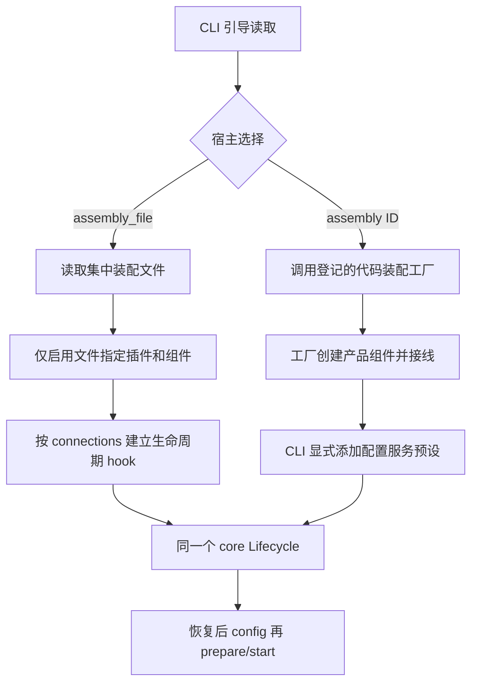

文件模式目前只支持方法插头与 core 生命周期槽，尚不支持下文完整 Bot 执行图。代码模式仍由产品工厂和各 `.component()` 方法接线。不能把当前 Bot 图直接写成一份文件就宣称可运行，也不能在文件模式之外偷偷附加旧图。

### 4.2 已落地的配置服务预设

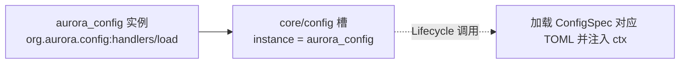

这是 [assembly.toml](../packages/aurora_config/src/aurora_config/assembly.toml) 的唯一连接，priority=0。配置端点没有额外 hook；服务关闭由 stop_accepting 清空端点的 files 引用。启用 world/configuration 仅添加声明，不创建 world 来源。

### 4.3 默认 Bot 与 MCP Bot 的实例身份

定义 `A = DefaultAssembly(..., instance_id=...)` 的装配所有者，默认 `default`；`B = bot 配置的 instance_id`，包模板默认 `main`，onboarding 为 `onboarding`。

| 实例                                                             | 实际对象或作用域                        | 创建条件                                              |
| ---------------------------------------------------------------- | --------------------------------------- | ----------------------------------------------------- |
| `aurora_config`                                                  | ConfigurationService                    | CLI 代码模式预设；文件模式由配置决定                  |
| `aurora_adapter/mcp`                                             | MCPClients                              | 选择 MCP Bot 装配                                     |
| `aurora_adapter/mcp/tools`                                       | MCPTools 目录桥                         | 选择 MCP Bot 装配                                     |
| `A/model`                                                        | DefaultAssembly 模型资源生命周期作用域  | 默认或 MCP Bot                                        |
| `A/bot`                                                          | DefaultAssembly 产品生命周期作用域      | 默认或 MCP Bot                                        |
| `A/records`                                                      | WorldRecords                            | 已登记 cadence 配置或 world 来源配置                  |
| `A/cadence`                                                      | Cadence                                 | 已登记 cadence 配置                                   |
| `A/world`                                                        | WorldSources 与来源配置处理器共用作用域 | 已登记 world 来源配置；MCP world 可替换其来源工厂注入 |
| `B`                                                              | ReActAgent                              | prepare_bot 创建                                      |
| `B/model`、`B/tools`                                             | ModelCall、ToolExecutor                 | prepare_bot 创建                                      |
| `B/build_prompt`、`B/interpret_response`、`B/record_observation` | ReActDefaults 的三个执行插头实例        | defaults.connect 创建                                 |
| `B/tool/<selection.instance_id>`                                 | 所选 ToolSpec 的工具实例                | prepare_bot 调用工具工厂；动态 MCP 工具也走这里       |
| `source_id`                                                      | SourceInstance 的来源身份               | world/config 中逐项选择；不是独立 LifecycleComponent  |

`A/model` 和 `B/model` 分属资源生命周期作用域与执行实例，即使 A 与 B 恰好相等，定义 ID 仍不同。目标方案应显式记录这两类身份，不能靠字符串相同推断同一个对象。AgentRuntime、模型客户端、端点和编排对象目前也不是每个都有独立 hook 实例身份。

### 4.4 生命周期依赖图

下图箭头只表示“后者 depends_on 前者”，不是插头连线。图示启用全部可选能力的 MCP Bot；没有 world/cadence 时删掉对应节点。

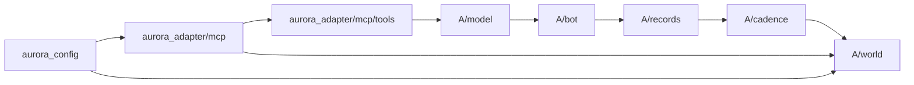

普通 Bot 没有 MCP 两个节点，A/model 的外部 depends_on 默认空；CLI 将配置组件放在产品组件之前。Lifecycle 对所有组件先完成整个 config 阶段，再整体 prepare/start。没有 cadence 时 A/world 直接依赖 A/records；普通 world 没有对 MCPClients 的依赖。

下表列出各作用域的真实 hook 连边。每个单元格均表示 `该处理器@该行实例 → core/该列阶段@该行实例`，priority 全为 0。缩写在表后给出完整前缀，附录 A 列出每一个完整 ID。

| 槽作用域                 | config 插头             | prepare 插头          | start 插头          | stop 插头          | clean 插头          | 本地 stop_accepting            |
| ------------------------ | ----------------------- | --------------------- | ------------------- | ------------------ | ------------------- | ------------------------------ |
| aurora_config            | config:load             | —                     | —                   | —                  | —                   | ConfigurationService.close     |
| aurora_adapter/mcp       | mcp:configure           | mcp:prepare           | —                   | mcp:stop           | mcp:clean           | MCPClients.stop_accepting      |
| aurora_adapter/mcp/tools | —                       | mcp:tools/prepare     | —                   | —                  | —                   | 无                             |
| A/model                  | —                       | bot:prepare_model     | —                   | —                  | bot:clean_model     | 无                             |
| A/bot                    | —                       | bot:prepare_bot       | bot:start_bot       | bot:stop_bot       | bot:clean_bot       | DefaultAssembly.stop_accepting |
| A/records                | —                       | world:records/prepare | world:records/start | world:records/stop | world:records/clean | 无                             |
| A/cadence                | —                       | cadence:prepare       | cadence:start       | cadence:stop       | cadence:clean       | Cadence.stop_accepting         |
| A/world                  | world:sources/configure | world:sources/prepare | world:sources/start | world:sources/stop | world:sources/clean | WorldSources.stop_accepting    |

前缀：`config:` = `org.aurora.config:handlers/`；`mcp:` = `org.aurora.adapter:handlers/mcp/`；`bot:` = `org.aurora.bot:handlers/assembly/`；`world:` = `org.aurora.world:handlers/`；`cadence:` = `org.aurora.bot:handlers/cadence/`；`core/<phase>` = `org.aurora.core:lifecycle/<phase>`。

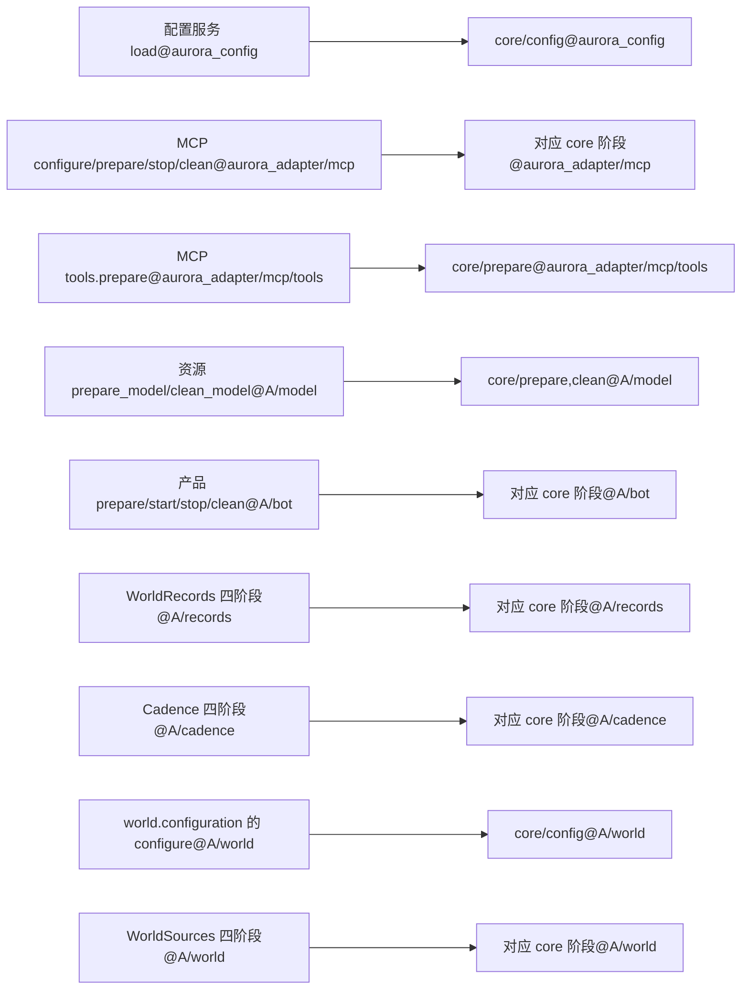

这里 world.configuration 与 world 两个插件共同服务一个 A/world 生命周期组件，是“一个插件一个实例”不成立的现成例子。API、模型协议、environment、memory、MCP world 和 MCP Bot 这些插件也不能凭插件名各画一套生命周期线：有些只提供协议/工厂，有些复用上述所有者。

来源：[DefaultAssembly.components](../packages/aurora_bot/src/aurora_bot/assembly.py)、[MCP Bot](https://github.com/AuroraBot-Dev/AuroraBot/blob/d6217150fa40fc72fc7fa580b177705a53eb7398/packages/aurora_adapter/src/aurora_adapter/mcp/bot.py)、[MCPClients](https://github.com/AuroraBot-Dev/AuroraBot/blob/d6217150fa40fc72fc7fa580b177705a53eb7398/packages/aurora_adapter/src/aurora_adapter/mcp/clients.py)、[MCPTools](https://github.com/AuroraBot-Dev/AuroraBot/blob/d6217150fa40fc72fc7fa580b177705a53eb7398/packages/aurora_adapter/src/aurora_adapter/mcp/tools.py)、[world 配置](../packages/aurora_world/src/aurora_world/configuration.py)、[cadence](../packages/aurora_bot/src/aurora_bot/cadence/forwarder.py)。

## 5 当前业务执行与数据接线

### 5.1 ReAct 默认执行图

图中 `R/` 表示 `org.aurora.agent:react/`；插头全名见紧随其后的表。实线为插头插入槽，虚线为普通调用。

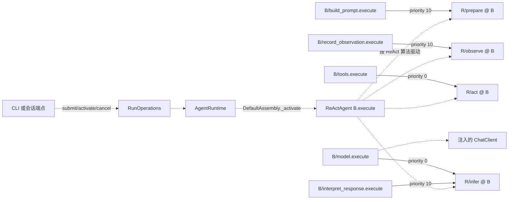

| 插头 ID                                                      | 插头实例             | 插槽 ID                          | 槽实例 | priority |
| ------------------------------------------------------------ | -------------------- | -------------------------------- | ------ | -------- |
| `org.aurora.agent:handlers/react/build_prompt/execute`       | B/build_prompt       | `org.aurora.agent:react/prepare` | B      | 10       |
| `org.aurora.agent:handlers/model_call/execute`               | B/model              | `org.aurora.agent:react/infer`   | B      | 0        |
| `org.aurora.agent:handlers/react/interpret_response/execute` | B/interpret_response | `org.aurora.agent:react/infer`   | B      | 10       |
| `org.aurora.agent:handlers/react/execute_tools/execute`      | B/tools              | `org.aurora.agent:react/act`     | B      | 0        |
| `org.aurora.agent:handlers/react/record_observation/execute` | B/record_observation | `org.aurora.agent:react/observe` | B      | 10       |

infer 槽先调用模型，后解释响应。默认图没有给 `react/finish`、`react/error` 接入处理器，也没有给 `tools/before_call`、`tools/after_call` 接入处理器，不能遗漏这些空槽或把它们画成默认已连接。

`org.aurora.agent:handlers/react_agent/execute` 已导出，但默认 Bot 是通过 `_activate → agent.execute` 普通调用进入，没有一条“AgentRuntime 插槽 → ReAct 插头”的真实 hook 连接。目标若要把这条边转成端口，需要单独定义和迁移，不能在现状图中补造。

来源：[ReActDefaults.connect](../packages/aurora_agent/src/aurora_agent/react_defaults.py)、[ReActAgent](../packages/aurora_agent/src/aurora_agent/react.py)、[AgentRuntime](../packages/aurora_agent/src/aurora_agent/runtime.py)、[DefaultAssembly._activate](../packages/aurora_bot/src/aurora_bot/assembly.py)。

### 5.2 工具实例插入执行器

所有下列工具实例插入同一个业务槽：`org.aurora.agent:handlers/react/execute_tools/children @ B/tools`。ToolExecutor 依据模型工具名选择对应连接，并非顺序执行全部已插入工具。

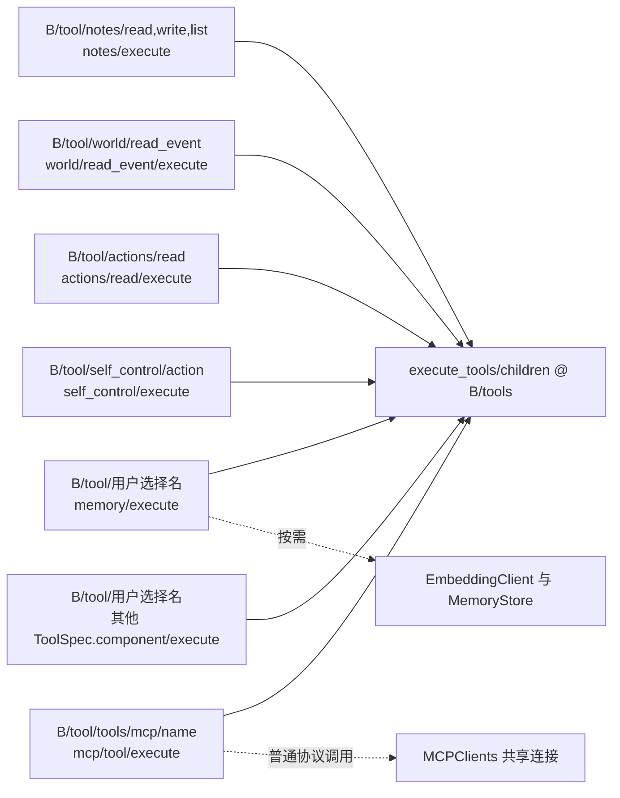

上图表示可选连边集合，不是默认全部启用。工具 ID 与执行插头 ID 不同：三个 notes 工具复用一个 `org.aurora.bot:components/notes/execute` 定义；五个 memory 工具复用一个 memory/execute 定义；所有动态 MCP 工具复用一个 MCPTool/execute 定义，但每个选择有自己的实例和 input/output 地址。

| 选择来源                          | 工具实例命名与限制                                                                                                 |
| --------------------------------- | ------------------------------------------------------------------------------------------------------------------ |
| Bot 的显式 tools 列表             | `B/tool/<selection.instance_id>`；按 tool ID 取 ToolSpec.factory                                                   |
| notes.enabled                     | 自动添加 `notes/read`、`notes/write`、`notes/list`；不允许在 tools 再重复选择                                      |
| archive.enabled / actions.enabled | 自动添加 `world/read_event` / `actions/read`；前者需要 WorldRecords                                                |
| self_control.enabled              | 自动添加 status/autonomy/finish/schedule/list/cancel 六种动作                                                      |
| memory                            | 启用插件只登记五种工具；实例仍需由 tools 选择。auto_compaction 是另外一条普通服务注入路径                          |
| MCP Bot additions                 | 将发现且未被显式选择的工具加入列表；默认 selection.instance_id 为动态 tool ID 的 local_path，即 `tools/mcp/<name>` |

动态 ID 范围为 `org.aurora.adapter:tools/mcp/<name>`。目录筛选和重命名来自 MCP 配置，静态清单不能提前列出 `<name>` 的实际集合。连接和工具名称映射由 `ToolExecutor.connect` 建立；工具关闭由产品持有的 ToolInstance.aclose 执行，没有独立的 memory 或单工具 lifecycle hook。

### 5.3 默认状态绑定表

下表 K 均为 `org.aurora.bot:state/` 下的键；实例定位使用 `instance_id=B`。

| 消费者角色                            | K 与 location                                                 | 是否按 run_id 区分 |
| ------------------------------------- | ------------------------------------------------------------- | ------------------ |
| ReAct inbox / progress                | `agents`，part=inbox/progress                                 | 否                 |
| ReAct runtime                         | `run`                                                         | 否                 |
| ReAct batch / decision                | `react_work`，part=batch/decision                             | 是                 |
| ModelCall input / output              | `react_work`，part=model_input/model_output                   | 是                 |
| ToolExecutor input / output / current | `react_work`，part=tool_calls/tool_results/tool_current       | 是                 |
| 单工具 input / output                 | `react_work`，part=tool/selection.instance_id/input 或 output | 是                 |
| 默认阶段 context                      | `messages`                                                    | 否                 |

目前这些地址由 DefaultAssembly 的 `_fixed/_work` 决定。目标中应将其作为产品预设的状态绑定，agent、模型调用和通用工具不再反向检查“必须是 Bot 的 WORK”。快照恢复不代表续跑；取消等待者与显式取消执行继续分开处理。

### 5.4 world、cadence、记忆与产品视图

本图全部为普通调用、状态读写或订阅，没有画 hook 实线。

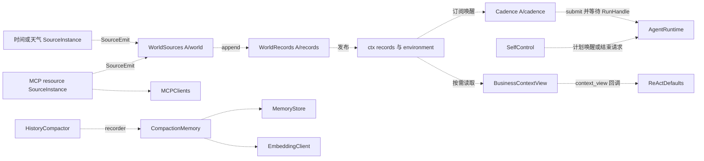

WorldSources 负责 SourceInstance.start/stop/aclose 和可选 run 主循环；environment 与 MCP world 提供的是 SourceSpec 工厂，复用 WorldSources 生命周期。存在 on_context_change 回调时，WorldSources 自己订阅 ctx 并通知来源。cadence 的普通模式订阅 RECORDS、ENVIRONMENT、SELF_CONTROL；决策模式监听 ctx 后过滤并合并变化。它们都是能力内部行为，不应把每条 ctx 通知升级成由中心配置调度的业务流程。

自动压缩记忆由 DefaultAssembly 给 HistoryCompactor 注入 CompactionMemory；它不是 tools/before_call 或 after_call 上的现有处理器。动作证据通过 ToolExecutor.recorder、观察转换通过回调注入，也不能伪装成已存在的 hook。

来源：[来源协议与托管](../packages/aurora_world/src/aurora_world/sources.py)、[事件记录](../packages/aurora_world/src/aurora_world/records.py)、[MCP world](https://github.com/AuroraBot-Dev/AuroraBot/blob/d6217150fa40fc72fc7fa580b177705a53eb7398/packages/aurora_adapter/src/aurora_adapter/mcp/world.py)、[记忆工具](../packages/aurora_bot/src/aurora_bot/memory/__init__.py)、[自动压缩记忆](../packages/aurora_bot/src/aurora_bot/memory/automatic.py)。

### 5.5 API 与命令的真实连接

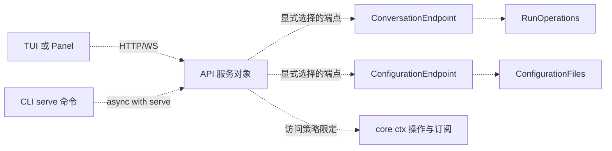

`aurora_api` 插件只登记 `org.aurora.api:registries/endpoints`。目录接纳一个 Endpoint 不代表 HTTP 监听已开启，也不代表端点已对外开放；serve 的 endpoints/keys 仍显式选择。CLI 的九个内部插件见附录 B，其 executor/operation 调度不是 hook 接线。

### 5.6 正式 onboarding 与控制回归图

[onboarding host.toml](../examples/onboarding/config.tomls/host.toml) 启用 MCP Bot、配置、模型、agent 和 API 共 11 个入口。它不启用 world、cadence、memory；业务 B=onboarding，生命周期 A=default。实际生命周期为 `aurora_config → MCPClients → MCPTools → default/model → default/bot` 的依赖链；执行图使用第 5.1 节的 B=onboarding，加上筛选出的 terminal MCP 工具。API 是否监听取决于启动命令，不由这 11 个插件自动决定。

control 的五种组件没有进入默认 Bot 的当前 hook 拓扑。其真实组合示例保存在[控制流回归夹具](../tests/fixtures/runtime_apps/control_flow/main.py)，不是新增用户示例。以下实线表示执行插头插入 children 槽：

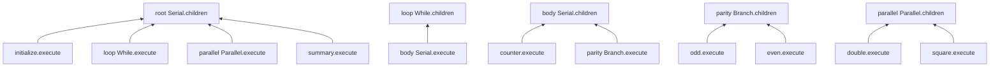

root 按连接插入顺序运行 initialize、loop、parallel、summary；loop 的 children 接 body；body 接 counter 和 parity。控制节点图中 execute/children 是同一实例的两个端口，分开画以保留插入方向；实际槽的完整定义在附录 A。选择器、循环条件、并发调度仍由代码实现，不设计 TOML 表达式语言替代这些算法。

## 6 现有边界中需要处理的问题

| 问题                             | 代码事实                                                                          | 拆分应解决的结果                                                       |
| -------------------------------- | --------------------------------------------------------------------------------- | ---------------------------------------------------------------------- |
| adapter 成为跨层集合             | 同包有模型协议、供应商实现、MCP 协议和导入 DefaultAssembly 的产品桥               | 模型与 MCP 有各自能力归属；产品预设不再位于协议包                      |
| assembly 等同于产品总入口        | 同一插件登记笔记、归档、动作、自控制、运行、会话和配置                            | 可以启用运行服务而不被迫登记全部工具；装配只选择能力                   |
| 工具能力被挂在 agent 包下        | MCP、memory、notes 等通过 agent.tools 才能使用 ToolSpec/ToolInstance/ToolExecutor | 普通工具可以在没有 ReAct 或聊天模型的环境里独立执行                    |
| 配置包承担宿主执行               | AssemblyPlan.assemble 创建实例并建立连接，CLI host 同时管理进程资源               | 配置能力只负责配置；宿主集中解释应用实例和连接                         |
| 元信息生成器跟着试点插件         | build_meta.py 定址到 aurora_config，构建 hook 按本包路径包含契约                  | 通用构建工具独立于配置插件；发布资源仍跟随所属发行包                   |
| 能力启用与实例创建混合           | DefaultAssembly 发现配置 ID 后自动创建 records/cadence/world                      | 实例列表显式决定是否创建；登记能力不隐含启动选择                       |
| 公共边仍由能力实现固定           | ReActDefaults.connect、各 component 方法直接接线                                  | 能力只导出端口；跨能力的边成为产品预设内容                             |
| memory 工厂硬认 Bot 地址         | 只接受 WORK 和 instance_id，读取 BOT_CONFIG，导入装配的凭证解析器                 | 注入存储 owner、工作地址、模型服务和凭证解析入口，不知道宿主具体是 Bot |
| 生命周期所有者与业务身份隐含关联 | A/default 与 B/main/onboarding 分别决定两套实例名                                 | 配置显式命名与引用，不靠字符串拼接猜资源归属                           |
| package 安装范围过宽             | bot 基础依赖 adapter[litellm] 和 world[config]，CLI 基础依赖 API                  | 通用运行只安装必要库；产品 extra/预设负责选择供应商、来源及传输        |

这些问题大多早于元信息试点；新的集中装配让它们变得更明显。配置包内的通用装配执行和本包生成器则是试点新增的责任，需要一起纠正，不能因为已经合并就当作目标架构。

## 7 建议的 package 与插件目标边界

本节所有新包名、新插件名均为建议命名，尚未创建。拆出独立发行包的依据是已有独立消费者、依赖范围和职责；同能力族的小插件仍可共用一个发行包。

### 7.1 目标发行与依赖方向

| 目标 package                    | 归属能力                                                                       | 目标插件或普通代码                                   | 依赖边界                                                                                 |
| ------------------------------- | ------------------------------------------------------------------------------ | ---------------------------------------------------- | ---------------------------------------------------------------------------------------- |
| `aurora_core`                   | 现有核心机制与纯声明绑定                                                       | 无需伪造 core entry point                            | 无项目上层依赖                                                                           |
| `aurora_control`                | 执行契约、地址绑定、控制组合                                                   | 保留 aurora_control 插件                             | core                                                                                     |
| `aurora_config`                 | schema/模板工具、ConfigSpec、配置加载与编辑                                    | 保留 aurora_config 插件；移出通用装配执行和生成器    | core；不要求启用 API                                                                     |
| `aurora_host`，新增             | 读取应用选择、创建组件、注入宿主服务、连接端口、生命周期入口                   | 普通宿主库，无业务插件                               | core/config/control；不依赖 agent、Bot、模型供应商或 MCP                                 |
| `aurora_model`，从 adapter 拆出 | 聊天/choice/embedding 契约、模型目录、模型配置、供应商适配                     | model、model.configuration、model.litellm 三类插件   | 基础依赖 core 与 tools 的中立数据契约；配置与 LiteLLM 分别由 extra 引入                  |
| `aurora_tools`，从 agent 拆出   | ToolSpec/Factory/Instance、工具目录、执行器、before/after 槽、工具调用数据契约 | aurora_tools 插件                                    | core/control，必要 schema 库；不依赖 ReAct 或模型供应商                                  |
| `aurora_agent`                  | ReAct、ModelCall、默认阶段实现、AgentRuntime、预算与压缩                       | 保留 model/react/react_defaults 三个插件；tools 移出 | core/control/model/tools；不依赖 Bot/CLI/API/MCP SDK                                     |
| `aurora_mcp`，从 adapter 拆出   | MCP 客户端与配置、MCP 工具桥、MCP world 桥                                     | aurora_mcp、aurora_mcp.tools、aurora_mcp.world       | 客户端依赖 core/config/MCP SDK；工具/world 桥通过各自 extra 依赖 tools/world；不依赖 Bot |
| `aurora_world`                  | 事件记录、环境视图、来源协议与托管、来源配置、环境来源                         | records/sources/configuration/environment 四个插件   | 基础 core；config、HTTP 来源依赖仍可通过 extra 引入                                      |
| `aurora_memory`，从 Bot 拆出    | 实例隔离的记忆存储与五种工具；可选压缩记忆集成                                 | aurora_memory；与 agent 压缩的桥按需启用             | core/config/model/tools；压缩桥才依赖 agent；不依赖 Bot                                  |
| `aurora_bot`                    | 具体产品状态、运行服务、自控制、cadence、交互、产品上下文；默认预设            | 拆成第 7.3 节的能力插件；默认装配变为预设资源        | 基础依赖所需 agent/config/core；world/memory/MCP/LiteLLM 由功能 extra 和预设显式选择     |
| `aurora_cli`                    | 命令发现、解析、输出、开发命令与宿主前端                                       | 保留命令插件机制；不复制 host 装配                   | host/logging；API 命令可选依赖 API                                                       |
| `aurora_api`                    | HTTP/WS、访问策略、端点目录                                                    | 保留端点目录插件；服务由宿主/命令显式创建            | core/aiohttp；不依赖 Bot                                                                 |
| `aurora_logging`                | 日志工具                                                                       | 普通库                                               | Rich；不增加插件                                                                         |
| `aurora_client` 与应用          | 客户端协议、交互和展示                                                         | 不承担 Python 装配                                   | TS 客户端和前端工具依赖                                                                  |
| 根产品分发                      | 默认安装集合和可选产品组合                                                     | 安装 extra、onboarding/默认 Bot 预设                 | 依赖上述可组合能力，不被这些能力反向引用                                                 |

这里没有要求把每个供应商、控制组件、工具动作都拆成独立 wheel。模型供应商先在模型能力包中作为独立插件和 extra；出现独立维护/版本发布需求时再拆发行包。MCP 工具/world 桥仍可与 MCP 客户端同发行，只要 import 和 extra 边界明确；它们属于 MCP 接入族，而 MCP Bot 装配必须回到产品侧。

工具与模型共享的数据定义按职责归位：ToolCall/ToolDefinition 等通用工具数据归 tools 的中立契约模块；模型消息协议引用它们。工具包不能为一个 JsonValue 类型反向依赖整个模型能力；一般 JSON 类型可以归 core 的已有 JSON 模块。agent 的 ToolResult 解释仍留在默认阶段，避免工具执行器了解 ReAct 历史结构。

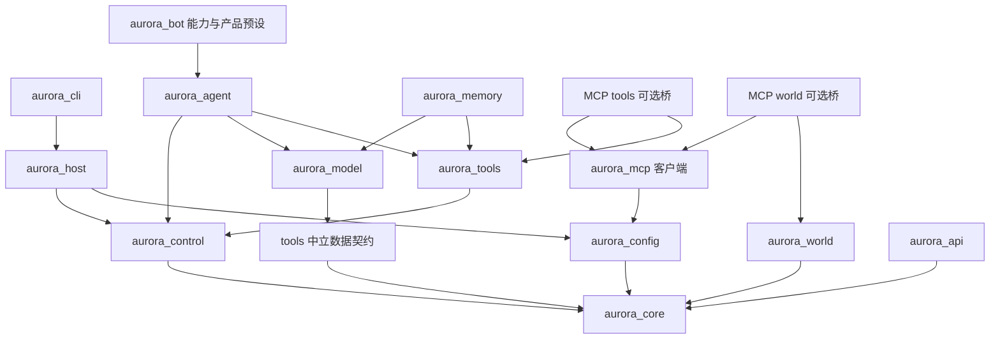

本图表示代码依赖的主要方向，产品选择的供应商和 world/memory 通过功能模块及 extra 补充；并非完整 Python 依赖锁文件。中立工具契约与执行器同发行，所以安装模型基础包也会传递安装 tools/control；协议模块本身只使用 core，不导入执行器、ReAct 或模型，不能让 `model → tools → model` 成环。

`aurora_host` 是对已存在的 `CLI host + AssemblyPlan.assemble` 的提取，有 CLI 与程序化宿主两个实际使用路径。它复用 core 的 Lifecycle，不再实现一套调度器；也不借此引入通用 harness、任意对象反射 DI 或新的任务执行框架。

### 7.2 当前全部插件的目标归属

目标名字用来表达方案；最终 entry point 变更按第 10 节单独迁移。

| 当前 Plugin.name            | 建议目标归属                                                   | 接线或接口变化                                             |
| --------------------------- | -------------------------------------------------------------- | ---------------------------------------------------------- |
| aurora_config               | 同名配置服务插件，位于 aurora_config                           | 工厂仍导出 LOAD；通用 assembly 执行移到 host               |
| aurora_control              | 同名控制能力插件，位于 aurora_control                          | 保留执行/children 定义；构造参数和实例连接由应用选择       |
| aurora_adapter.model        | aurora_model、aurora_model.configuration、aurora_model.litellm | 协议目录、配置声明、供应商实现分开启用                     |
| aurora_adapter.mcp          | aurora_mcp                                                     | 保留客户端生命周期与配置；消费者注入共享实例               |
| aurora_adapter.mcp.tools    | aurora_mcp.tools                                               | 依赖新的 tools 契约；发现工具不等于自动创建全部工具实例    |
| aurora_adapter.mcp.world    | aurora_mcp.world                                               | 提供来源工厂，客户端绑定由宿主明确                         |
| aurora_adapter.mcp.bot      | 产品 MCP Bot 预设                                              | 退出能力插件层；additions 策略变为预设中的显式动态选择     |
| aurora_agent.model          | 同名插件，仍在 aurora_agent                                    | 模型调用依赖模型契约，不创建或关闭供应商客户端             |
| aurora_agent.react          | 同名插件，仍在 aurora_agent                                    | 保留六阶段与 execute；外部边由集中配置决定                 |
| aurora_agent.tools          | aurora_tools                                                   | 移出通用工具目录、执行器和端口，不携带 ReAct 依赖          |
| aurora_agent.react_defaults | 同名插件，仍在 aurora_agent                                    | 保留三个阶段实现；移除自动 connect，连接进入产品预设       |
| aurora_world                | aurora_world.records、aurora_world.sources                     | 同包内拆开记录和来源托管，可独立选择；两者通过服务注入协作 |
| aurora_world.configuration  | 同名配置桥，仍在 aurora_world                                  | 只声明配置并导出 configure，不自行创建/接线 WorldSources   |
| aurora_world.environment    | 同名来源插件，仍在 aurora_world                                | 时间/天气来源作为工厂导出，无需伪造 lifecycle 插头         |
| aurora_bot.assembly         | 产品预设 + 第 7.3 节能力插件                                   | 退掉“大总管”入口；资源、状态、工具、交互分别有 owner       |
| aurora_bot.cadence          | 同名产品能力插件，仍在 aurora_bot                              | 依赖运行能力和 world 服务，不依赖装配插件；保留内部订阅    |
| aurora_bot.memory           | aurora_memory；产品压缩组合进入预设                            | 去掉对 Bot WORK/BOT_CONFIG 的硬编码依赖                    |
| aurora_api                  | 同名端点目录插件，仍在 aurora_api                              | 监听器是宿主显式创建的服务；不自动启动 HTTP                |

### 7.3 Bot 大插件的内部拆分

这些先是同一发行包里的逻辑插件，不因数量增加就拆出多个 package。

| 建议插件/资源                        | 当前代码能力                                                                      | 独占责任及关键协作                                                                     |
| ------------------------------------ | --------------------------------------------------------------------------------- | -------------------------------------------------------------------------------------- |
| aurora_bot.runtime                   | RunOperations、产品 AGENTS/MESSAGES/RUN/WORK、运行相关配置、AgentRuntime 资源绑定 | 拥有产品实例状态地址和运行接纳/关闭；调用 agent，不复制执行机制                        |
| aurora_bot.conversation              | ConversationEndpoint 与传输契约                                                   | 只处理产品会话交互，注入 runtime；端点登记不要求 HTTP 已启用                           |
| aurora_bot.commands                  | submit/activate/cancel 命令                                                       | CLI 描述与显示，消费运行操作；不持有另一套运行状态                                     |
| aurora_bot.notes                     | WorkNotes、notes 状态与三个工具                                                   | 笔记与工具输入输出，地址/owner 由装配注入                                              |
| aurora_bot.actions                   | ActionEvidence、行动证据读取工具、观察转换                                        | 完整证据与受限观察；由工具执行器/默认阶段显式引用 recorder 和转换服务                  |
| aurora_bot.self_control              | SelfControl、对应状态和六个工具                                                   | 产品自主开关、当前轮结束、计划唤醒；明确注入唯一 runtime                               |
| aurora_bot.world_view                | BusinessContextView、world/read_event 工具                                        | 产品对世界记录的视图与读取适配；不拥有 world 来源和归档存储                            |
| aurora_bot.cadence                   | Cadence 与 checkpoint/config                                                      | 世界输入转发/可选决策；注入 world、runtime 和可选 choice 客户端                        |
| 默认 Bot / MCP Bot / onboarding 预设 | DefaultAssembly 和 MCP Bot 的公开组合选择                                         | 保存插件选择、实例、资源引用、状态地址、接线、顺序和动态工具选择策略，不拥有业务处理器 |

模型客户端的创建/关闭归模型能力导出的资源工厂及实例；宿主负责其生命周期。当前 prepare_model/clean_model 中的资源行为应迁入模型资源组件，产品工具选择与能力要求留在产品组合层。现有 prepare_bot/clean_bot 中分散的工具、world、memory、actions 资源也要分别归位，不能只换类名并保留一个更大的总工厂。

HistoryCompactor、ModelInputBudget 仍归 agent；MemoryStore 归 memory；二者的 recorder 组合由预设显式选择。AgentRuntime 的执行与取消语义仍归 agent，产品 runtime 只是暴露入口和管理被装配实例，不新增第二个调度所有者。

## 8 元信息与集中装配的唯一来源

### 8.1 清单按插件归位，目录按发行包汇总

建议将试点的“每个发行包一份清单”收敛为：每个逻辑插件一份相邻的 `plugin.meta.toml`；发行包构建将多份清单汇总成一个静态能力目录。单插件发行包仍可以把清单放在包根，无需强制搬动 aurora_config。

```text
packages/aurora_model/
  pyproject.toml                     发行依赖和 entry point 映射
  src/aurora_model/
    contract/                        普通协议代码，不必是插件
    plugins/
      model/plugin.meta.toml         模型公共目录和契约
      configuration/plugin.meta.toml  配置声明
      litellm/plugin.meta.toml        供应商实现
  生成的声明模块                     不手工修改公共 ID
wheel/.dist-info/extra_metadata/plugin.meta.json
```

这是目标组织示意，不是当前目录。构建配置只列要收集的清单路径和生成模块落点，不重写插件名、ID 或契约。pyproject 继续独占 entry point 名称和工厂路径；清单用 entry_point 引用。生成工具迁入开发工具目录，运行时不要求安装生成器，更不要求所有插件依赖 aurora_config。

| 信息                                             | 唯一编辑来源                    | 其他位置如何使用                                     |
| ------------------------------------------------ | ------------------------------- | ---------------------------------------------------- |
| 发行版本、依赖、extra、entry point               | pyproject.toml                  | 构建静态目录合并发行元数据                           |
| 公共 ID、kind、定义所属插件、用途、导出端口      | 对应插件的 plugin.meta.toml     | 生成常量/声明，静态浏览使用生成目录                  |
| 字段结构和验证语义                               | 单个 schema 或纯契约导出函数    | 元信息引用，生成器展开；不再手写第二套结构           |
| 方法实现哪个插头                                 | `@plug(生成 ID)` 与显式工厂导出 | 不包含目标槽和目标实例                               |
| 工厂实现、内部资源、ctx 订阅、何时调用槽         | Python                          | 不把所有私有动作变成配置表达式                       |
| 实例、外部服务绑定、状态角色绑定、依赖、公开连边 | 选定的一份应用装配配置/预设     | 宿主执行，不与插件内部隐藏连边叠加                   |
| 用户配置值                                       | 用户 TOML                       | ctx 非持久配置；运行覆盖不自动写回                   |
| 动态 MCP 工具实际目录                            | prepare 的协议发现结果          | 清单描述范围；配置给出选择规则；运行图显示展开后实例 |

共享定义只有一个拥有者。多个插件可以引用同一个工具契约/状态 ID，但不能各复制一份登记。package、Plugin.name、provider、公共 ID 命名空间分别展示，不用其中任意一个替代其他身份。

### 8.2 宿主只执行组合，不理解业务算法

宿主负责：按显式选择加载插件；建立 registry/ctx/storage/hooks；创建组件和资源；注入声明的依赖；绑定端口；建立 LifecycleComponent；恢复、启动、运行命令和最终释放。

插件负责：实现能力、导出定义和可装配对象、维护自己负责的状态和内部订阅、在自己的业务时机调用槽、报告本地资源的关闭动作。执行结束继续通过 await 判断。

接线分两类明确处理：生命周期方法继续由 HookConnections 建立；执行端口必须走 ExecutionSlot.connect(ExecutionPlug)，保留状态地址握手。服务对象/资源工厂注入是显式依赖引用，不强行转换成无参数 hook，也不在 core 增加全局 schema 兼容判定器。

沿用信任开发者的原则：保留定位错误所需的缺失 ID、重复身份、不可用依赖和契约类型检查，具体插件的参数语义由其自身负责。不开辟权限审批、插件沙箱、任意 schema 兼容推理或多层兜底系统；错误直接指出清单、实例与端口。

共享服务必须有一个资源 owner，借用者不能重复关闭。同一个 AgentRuntime 只拥有一个 agent 的调度权；引用了它的会话、命令、cadence、self_control 不各自创建新 runtime。

### 8.3 动态工具与 bootstrap 的顺序

集中配置必须在配置服务启动前读取。不能让配置插件在自己的 config 阶段反过来决定“配置插件是否存在、它接到哪里”。

MCP 工具名又只有连接后才能确定。因此目标应分清静态组件图与动态工具实例展开：应用预设显式声明使用哪一个 MCP 目录、include/exclude/命名规则和工具所有者；MCPTools.prepare 只发现并登记目录；随后宿主安排的工具实例准备阶段按这份选择展开实例和连边。保持当前“先客户端、再目录、再模型能力检查和工具实例化”的依赖，不把目录发现塞进静态元信息生成或 import。

动态展开后的运行图记录具体 tool ID、实例 ID、来源目录和连接；配置仍是选择策略的唯一来源。不得默认为所有已安装插件、所有远端工具都创建实例，也不需要引入在线热重装配、任意 Python 对象配置语言或授权审批层。

## 9 建议的目标实例图

本节图为目标设计，普通虚线依赖尚未统一支持配置引用；不提供伪装成当前可执行的完整 TOML。

### 9.1 宿主与能力装配

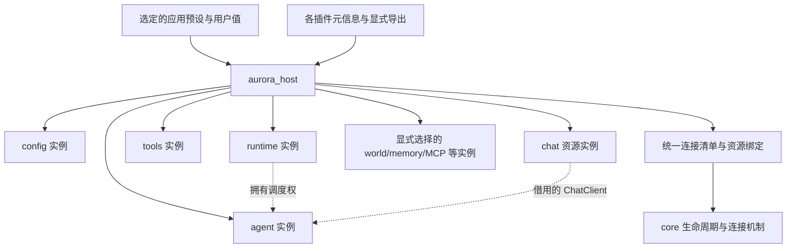

图中 Host 实线表示创建与装配责任，不是 hook。每个实际拥有外部资源的组件可有自己的 core 生命周期作用域，哪个插件的哪些方法插入这些槽由预设声明；纯处理器无需伪造五个空生命周期方法。

### 9.2 保留业务含义的端口连接

下面的节点名是建议的实例别名，完整公共端口身份在正式迁移决定前沿用附录中的定义来表达。实线仍表示插头插入槽，虚线为服务注入/调用。

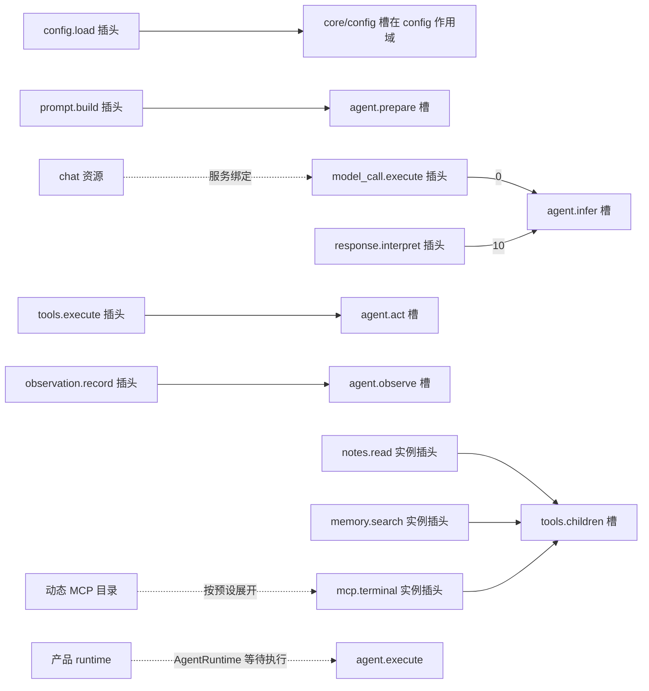

这张图不新增“runtime 槽”或“模型服务槽”，也不把当前 AgentRuntime/ChatClient 的普通调用伪装成 hook。是否把它们升级为公开执行端口是后续能力设计问题。第一步集中化现有真实端口，就已能替换 infer 实现、选择工具、增删观察阶段，而无需再经过 DefaultAssembly 的隐藏 connect。

### 9.3 所有者与生命周期关系

| 资源/对象                               | 目标唯一 owner                             | 借用者或调用者                        | 关闭责任                                               |
| --------------------------------------- | ------------------------------------------ | ------------------------------------- | ------------------------------------------------------ |
| registry/ctx/hooks/storage/persistence  | 宿主                                       | 所有已启用组件                        | 所有组件收尾后宿主释放                                 |
| ChatClient/ChoiceClient/EmbeddingClient | 配置选定的模型资源实例                     | ModelCall、cadence、memory、compactor | 对应模型资源组件；先停止消费者                         |
| MCP 会话/子进程                         | MCPClients 实例                            | MCP 工具和资源来源                    | MCPClients；消费者先结束在途操作                       |
| WorldRecords/归档                       | world.records 实例                         | 来源、视图、cadence、归档工具         | world.records，消费者先停止                            |
| SourceInstance                          | world.sources 实例                         | world 内部通知和监督                  | world.sources 负责 stop/aclose                         |
| 工具实例                                | 装配指定的工具所有者                       | ToolExecutor                          | 所有者调用 ToolInstance.aclose；未返回工厂自理部分资源 |
| AgentRuntime                            | 产品 runtime 实例                          | 命令、会话、cadence、自控制           | runtime 停止接纳并等待运行结束                         |
| MemoryStore/后台索引                    | memory 实例                                | 显式记忆工具、可选压缩桥              | memory 组件；不由 Bot 猜测内部任务                     |
| HTTP 服务                               | 宿主选定的 API 服务实例或 serve 命令作用域 | 客户端                                | 所属作用域关闭监听和连接                               |

代码约定中的对象内部联系无需全部写入预设；跨插件可替换的依赖必须能在装配视图中看到。生命周期依赖用来保障资源先准备、消费者先关闭，不要求整个执行图是 DAG；循环仍由 While/ReAct 的业务实现解释。

## 10 拆分顺序与验收边界

### 10.1 先审查，再实施

1. **当前阶段只完成能力归属与接线审查。** 暂停其他插件的 plugin.meta.toml 迁移，不修改现有源码、入口、配置或用户数据。先确认第 7 节目标能力与宿主职责。
2. **提取已有宿主与生成责任。** 把通用装配执行从 config、进程宿主从 CLI 提到薄 host 库；配置服务试点继续可用。构建生成工具独立于业务插件，支持多插件目录汇总。
3. **厘清中立契约和依赖。** 先抽 tools 中立契约/执行器，再分开模型与 MCP；防止重命名后留下 model/tools 相互依赖。验证无 ReAct/模型 SDK 的工具执行及无 MCP/供应商 SDK 的 agent 使用。
4. **拆 Bot 逻辑插件与产品预设。** 按第 7.3 节逐组转移定义与资源 owner，把现有每条边和状态绑定纳入同一份预设。每次迁移同步删除相应旧自动接线，不留下两套活跃默认图。
5. **解耦 memory、world 子能力和可选传输。** 去掉具体 Bot 地址检查，保留存储隔离和合法参数约束；明确 API 命令的可选安装与启用路径。
6. **逐个补齐元信息、工厂导出和图查询。** 对照附录清点，不用一次性重写全部插件。最终可以从静态目录看能力、从配置看计划图、从宿主看实际实例图。

步骤 2—6 都是后续计划，不构成本次实施授权。模板改名 `plugin.config.toml(s)` 与这次能力拆分分别处理，不能顺带移动或覆盖用户文件。

### 10.2 名称与数据迁移的明确决定

| 身份或路径                | 影响                                           | 推荐处理                                                       |
| ------------------------- | ---------------------------------------------- | -------------------------------------------------------------- |
| Python 发行包/import 路径 | 安装、锁文件、extra、消费者、wheel             | 一次切换受影响消费者和发布资源，不保留无消费者的转发包         |
| Plugin.name/entry point   | host/assembly 配置中的启用列表、requires       | 形成旧→新明确映射，给出用户配置修改说明；不静默加载“别名插件”  |
| 公共定义 ID               | 插头连接、状态键、工具选择、模型绑定、索引身份 | 把名称调整与物理搬包分开审查；不能只做代码搜索替换就认定完成   |
| 生命周期/业务实例 ID      | 连接寻址、资源关联、状态 location 与多实例隔离 | 给出 A/B 到新实例别名的映射，保留业务 owner 与数据归属         |
| 配置资源与用户文件路径    | 模板复制、现有配置定位                         | 模板来源与用户路径分别声明，旧文件不覆盖、不自动改名           |
| SQLite/快照/记忆索引      | namespace 目录、owner、schema、模型指纹        | 记录新旧存储映射；用户选择独立目录或显式迁移，失败不删除旧数据 |

当前 AGENTS.md 要求公开定义按所属包命名。若采用“物理搬包先保留既有公共 ID”的策略，需要先单独确认并调整这一约定，使稳定的能力身份与发行包位置分开；本文不修改 AGENTS.md，也不声称已经获得该规则变更授权。如果维持现有命名规则，则跨包迁移必须同时列出新旧 ID、配置和快照迁移方案。

推荐优先保持公共身份稳定，在有充分理由时再更名；例如当前 `org.aurora.adapter:adapters/model/litellm/...` 会参与记忆索引指纹，改名字可能触发重建成本。新包名绝不等于可以自动改写用户数据的许可。

### 10.3 每一步的验收要求

- 静态清点：每个定义恰好有一个拥有者；requires 与实际使用的协议匹配；无端口的插件明确标注，不凑数创建槽。
- 图等价：现有生命周期表、五条默认 ReAct 连边、工具选择映射与状态地址保持业务语义；迁移后先核对实际图，再验证运行。
- 引导与动态发现：配置服务能自举；MCP 目录在 prepare 后展开；插件发现/静态目录读取不连接供应商或启动后台任务。
- 资源与并发：唯一运行所有者；取消等待不隐式取消 agent；启动失败和关闭完成后释放资源；共享 MCP/模型服务没有双重关闭。
- 独立安装：wheel 之外的源码不可作为依赖补丁；core/control/tools、agent、memory、MCP 各验证其声明的最小安装环境，CLI 本地路径不必拉入 HTTP 服务。
- 回归：按受影响包、协议与宿主执行相关用例，并完成跨包完整检查；不为通过检查忽略未登记快照、删除有效断言或放宽真实业务错误。
- 文档与使用入口：同步清单、配置、消费者、预设、安装助手和 ID 目录；README/AGENTS 变更按项目规则另行确认。

## 11 当前清点的核对范围

附录 A 来自全部已安装 entry point 的 Plugin 工厂返回值；仅发现和登记定义，没有实例化远端服务。生命周期图在临时存储目录中创建配置服务、MCP Bot 与可选组件后读取 HookConnections，未调用 config/prepare/start。ReAct 五条默认连边使用真实 ReAct/ModelCall/ToolExecutor/ReActDefaults 对象和假模型核对，未发起模型调用。它们核实定义与连接，不替代后续拆包的运行验收。

静态计数的边界是 18 个 entry point、145 个定义、42 个插头、14 个业务槽；core 五槽与 CLI 内部命令另列，MCP 动态目录不计数。图中参数化工具、source_id 以及条件分支依据对应工厂代码展开规则描述；用户实际运行图需要宿主加载其配置后另行查询。

本文继承[元信息与集中装配方案](aurora-meta-proposal.md)已落地的试点事实，但目标包边界、多清单组织和宿主归属以本次审查结论为后续讨论输入，不把旧方案的文件布局当成不可调整的约束。

## 附录 A 全部公开插件与定义

本附录按 entry point 排列。每节分别列出插头、插槽及其余定义，完整 ID 不使用省略前缀。无端口也明确列出，以免把工厂或目录误认为缺失接线。

端口契约记号：**L** 表示无参生命周期方法；**E** 表示 `ExecutionPlug.execute(ExecutionRequest)`，输入输出通过 StateBinding 地址传递。E 插头的 `interface` 是去掉末尾 `/execute` 后的 component ID；全部 14 个业务槽接收 E 插头，经 ExecutionSlot.connect 交换地址。L 不是 kind，E 也不是额外一种 ID。

“声明约束”仅描述代码中的 `RegistryEntry.slot`；它不是已建立连接。无约束的插头不会自行找到目标槽。旧声明的固定槽约束将在元信息迁移时与实际接线分开处理。`_declared` 是工具静态占位函数，必须通过 ToolSpec.factory 得到真正实例，不能直接执行占位函数。

### A.1 aurora_adapter.mcp

入口：`aurora_adapter.mcp:plugin`；[定义来源](https://github.com/AuroraBot-Dev/AuroraBot/blob/d6217150fa40fc72fc7fa580b177705a53eb7398/packages/aurora_adapter/src/aurora_adapter/mcp/__init__.py)。requires：`aurora_config`。

实例 `aurora_adapter/mcp`，生命周期接线见第 4.4 节；工具与 world 来源借用同一个 MCPClients。

插头：4；插槽：0；其他定义：3。

| 插头 ID                                     | 契约与代码目标             | 声明约束                            |
| ------------------------------------------- | -------------------------- | ----------------------------------- |
| `org.aurora.adapter:handlers/mcp/configure` | L · `MCPClients.configure` | `org.aurora.core:lifecycle/config`  |
| `org.aurora.adapter:handlers/mcp/prepare`   | L · `MCPClients.prepare`   | `org.aurora.core:lifecycle/prepare` |
| `org.aurora.adapter:handlers/mcp/stop`      | L · `MCPClients.stop`      | `org.aurora.core:lifecycle/stop`    |
| `org.aurora.adapter:handlers/mcp/clean`     | L · `MCPClients.clean`     | `org.aurora.core:lifecycle/clean`   |

插槽：无。

| kind      | 定义 ID                                | 目标或工具执行插头 |
| --------- | -------------------------------------- | ------------------ |
| config    | `org.aurora.adapter:configs/mcp`       | `ConfigSpec`       |
| state_key | `org.aurora.adapter:state/mcp/config`  | `StateKey`         |
| state_key | `org.aurora.adapter:state/mcp/clients` | `StateKey`         |

### A.2 aurora_adapter.mcp.bot

入口：`aurora_adapter.mcp.bot:plugin`；[定义来源](https://github.com/AuroraBot-Dev/AuroraBot/blob/d6217150fa40fc72fc7fa580b177705a53eb7398/packages/aurora_adapter/src/aurora_adapter/mcp/bot.py)。requires：`aurora_adapter.mcp.tools`、`aurora_bot.assembly`。

没有自己的 hook 实例；装配工厂创建第 4.3—4.4 节的组件，并提供第 5.2 节的动态工具追加策略。

插头：0；插槽：0；其他定义：1。

插头：无。

插槽：无。

| kind     | 定义 ID                                         | 目标或工具执行插头 |
| -------- | ----------------------------------------------- | ------------------ |
| assembly | `org.aurora.adapter:assemblies/mcp/default_bot` | `assemble`         |

### A.3 aurora_adapter.mcp.tools

入口：`aurora_adapter.mcp.tools:plugin`；[定义来源](https://github.com/AuroraBot-Dev/AuroraBot/blob/d6217150fa40fc72fc7fa580b177705a53eb7398/packages/aurora_adapter/src/aurora_adapter/mcp/tools.py)。requires：`aurora_adapter.mcp`、`aurora_agent.tools`。

目录实例 `aurora_adapter/mcp/tools` 接 prepare；工具实例 `B/tool/tools/mcp/<name>` 接 ToolExecutor.children，见第 4.4、5.2 节。

插头：2；插槽：0；其他定义：1。

| 插头 ID                                          | 契约与代码目标         | 声明约束                            |
| ------------------------------------------------ | ---------------------- | ----------------------------------- |
| `org.aurora.adapter:components/mcp/tool/execute` | E · `MCPTool.execute`  | 无固定目标槽                        |
| `org.aurora.adapter:handlers/mcp/tools/prepare`  | L · `MCPTools.prepare` | `org.aurora.core:lifecycle/prepare` |

插槽：无。

| kind      | 定义 ID                                  | 目标或工具执行插头 |
| --------- | ---------------------------------------- | ------------------ |
| component | `org.aurora.adapter:components/mcp/tool` | `MCPTool`          |

动态发现的 `org.aurora.adapter:tools/mcp/<name>` 是 ToolSpec；其执行插头统一为 `org.aurora.adapter:components/mcp/tool/execute`。不把运行时目录项当作额外静态插件。

### A.4 aurora_adapter.mcp.world

入口：`aurora_adapter.mcp.world:plugin`；[定义来源](https://github.com/AuroraBot-Dev/AuroraBot/blob/d6217150fa40fc72fc7fa580b177705a53eb7398/packages/aurora_adapter/src/aurora_adapter/mcp/world.py)。requires：`aurora_adapter.mcp`、`aurora_world.configuration`。

工厂生成 `source_id` 对应的 SourceInstance，由 A/world 托管；经 MCP world 组件注入 MCPClients，没有额外 hook，见第 5.4 节。

插头：0；插槽：0；其他定义：2。

插头：无。

插槽：无。

| kind      | 定义 ID                                    | 目标或工具执行插头 |
| --------- | ------------------------------------------ | ------------------ |
| source    | `org.aurora.adapter:sources/mcp/resources` | `SourceSpec`       |
| state_key | `org.aurora.adapter:state/mcp/world`       | `StateKey`         |

### A.5 aurora_adapter.model

入口：`aurora_adapter.model.plugin:plugin`；[定义来源](https://github.com/AuroraBot-Dev/AuroraBot/blob/d6217150fa40fc72fc7fa580b177705a53eb7398/packages/aurora_adapter/src/aurora_adapter/model/plugin.py)。requires：`aurora_config`。

导出模型契约、配置和适配器；客户端由 A/model 普通调用工厂创建，B/model 借用。没有独立模型协议生命周期实例。

插头：0；插槽：0；其他定义：15。

插头：无。

插槽：无。

| kind      | 定义 ID                                               | 目标或工具执行插头 |
| --------- | ----------------------------------------------------- | ------------------ |
| registry  | `org.aurora.adapter:registries/model/adapters`        | `KindReceiver`     |
| service   | `org.aurora.adapter:services/model/embedding_client`  | `EmbeddingClient`  |
| service   | `org.aurora.adapter:services/model/choice_client`     | `ChoiceClient`     |
| service   | `org.aurora.adapter:services/model/chat_client`       | `ChatClient`       |
| schema    | `org.aurora.adapter:schemas/model/chat/request`       | `ChatRequest`      |
| schema    | `org.aurora.adapter:schemas/model/chat/response`      | `ChatResponse`     |
| schema    | `org.aurora.adapter:schemas/model/chat/chunk`         | `TypeAliasType`    |
| schema    | `org.aurora.adapter:schemas/model/chat/capabilities`  | `ChatCapabilities` |
| adapter   | `org.aurora.adapter:adapters/model/litellm/chat`      | `ModelAdapter`     |
| adapter   | `org.aurora.adapter:adapters/model/litellm/choice`    | `ModelAdapter`     |
| adapter   | `org.aurora.adapter:adapters/model/litellm/embedding` | `ModelAdapter`     |
| config    | `org.aurora.adapter:configs/model/profiles`           | `ConfigSpec`       |
| state_key | `org.aurora.adapter:state/model/config`               | `StateKey`         |
| config    | `org.aurora.adapter:configs/model/bindings`           | `ConfigSpec`       |
| state_key | `org.aurora.adapter:state/model/bindings`             | `StateKey`         |

### A.6 aurora_agent.model

入口：`aurora_agent.model:plugin`；[定义来源](../packages/aurora_agent/src/aurora_agent/model.py)。requires：无。

执行实例 `B/model` 的插头接 ReAct.infer；与持有客户端的 A/model 区分，见第 5.1 节。

插头：1；插槽：0；其他定义：1。

| 插头 ID                                        | 契约与代码目标          | 声明约束     |
| ---------------------------------------------- | ----------------------- | ------------ |
| `org.aurora.agent:handlers/model_call/execute` | E · `ModelCall.execute` | 无固定目标槽 |

插槽：无。

| kind      | 定义 ID                                | 目标或工具执行插头 |
| --------- | -------------------------------------- | ------------------ |
| component | `org.aurora.agent:handlers/model_call` | `ModelCall`        |

### A.7 aurora_agent.react

入口：`aurora_agent.react:plugin`；[定义来源](../packages/aurora_agent/src/aurora_agent/react.py)。requires：无。

执行实例 B 提供六个阶段槽；默认连接五条，finish/error 为空；其 execute 由 runtime 普通调用，见第 5.1 节。

插头：1；插槽：6；其他定义：1。

| 插头 ID                                         | 契约与代码目标           | 声明约束     |
| ----------------------------------------------- | ------------------------ | ------------ |
| `org.aurora.agent:handlers/react_agent/execute` | E · `ReActAgent.execute` | 无固定目标槽 |

| 插槽 ID                          | 接收契约与调用语义                       |
| -------------------------------- | ---------------------------------------- |
| `org.aurora.agent:react/prepare` | E · 每轮准备模型输入                     |
| `org.aurora.agent:react/infer`   | E · 调用模型并解释决策，按 priority 执行 |
| `org.aurora.agent:react/act`     | E · 执行工具等动作                       |
| `org.aurora.agent:react/observe` | E · 记录本轮观察                         |
| `org.aurora.agent:react/finish`  | E · 结束阶段；默认无连接                 |
| `org.aurora.agent:react/error`   | E · 错误阶段；默认无连接                 |

| kind      | 定义 ID                                 | 目标或工具执行插头 |
| --------- | --------------------------------------- | ------------------ |
| component | `org.aurora.agent:handlers/react_agent` | `ReActAgent`       |

### A.8 aurora_agent.react_defaults

入口：`aurora_agent.react_defaults:plugin`；[定义来源](../packages/aurora_agent/src/aurora_agent/react_defaults.py)。requires：`aurora_agent.react`、`aurora_agent.model`、`aurora_agent.tools`。

三个实例为 `B/build_prompt`、`B/interpret_response`、`B/record_observation`，连接见第 5.1 节。

插头：3；插槽：0；其他定义：3。

| 插头 ID                                                      | 契约与代码目标                         | 声明约束     |
| ------------------------------------------------------------ | -------------------------------------- | ------------ |
| `org.aurora.agent:handlers/react/build_prompt/execute`       | E · `ReActDefaults.build_prompt`       | 无固定目标槽 |
| `org.aurora.agent:handlers/react/interpret_response/execute` | E · `ReActDefaults.interpret_response` | 无固定目标槽 |
| `org.aurora.agent:handlers/react/record_observation/execute` | E · `ReActDefaults.record_observation` | 无固定目标槽 |

插槽：无。

| kind      | 定义 ID                                              | 目标或工具执行插头 |
| --------- | ---------------------------------------------------- | ------------------ |
| component | `org.aurora.agent:handlers/react/build_prompt`       | `ReActDefaults`    |
| component | `org.aurora.agent:handlers/react/interpret_response` | `ReActDefaults`    |
| component | `org.aurora.agent:handlers/react/record_observation` | `ReActDefaults`    |

### A.9 aurora_agent.tools

入口：`aurora_agent.tools:plugin`；[定义来源](https://github.com/AuroraBot-Dev/AuroraBot/blob/d6217150fa40fc72fc7fa580b177705a53eb7398/packages/aurora_agent/src/aurora_agent/tools.py)。requires：无。

执行实例 `B/tools` 接 ReAct.act，children 接所选工具；before_call/after_call 默认均为空，见第 5.1—5.2 节。

插头：1；插槽：3；其他定义：2。

| 插头 ID                                                 | 契约与代码目标             | 声明约束     |
| ------------------------------------------------------- | -------------------------- | ------------ |
| `org.aurora.agent:handlers/react/execute_tools/execute` | E · `ToolExecutor.execute` | 无固定目标槽 |

| 插槽 ID                                                  | 接收契约与调用语义                                |
| -------------------------------------------------------- | ------------------------------------------------- |
| `org.aurora.agent:handlers/react/execute_tools/children` | E · 按工具名选中对应插头并等待完成                |
| `org.aurora.agent:tools/before_call`                     | E · 每次工具调用前；可抛 ToolRejected；默认无连接 |
| `org.aurora.agent:tools/after_call`                      | E · 结果保存后观察；默认无连接                    |

| kind      | 定义 ID                                         | 目标或工具执行插头 |
| --------- | ----------------------------------------------- | ------------------ |
| registry  | `org.aurora.agent:registries/tools`             | `ToolReceiver`     |
| component | `org.aurora.agent:handlers/react/execute_tools` | `ToolExecutor`     |

### A.10 aurora_api

入口：`aurora_api.endpoints:plugin`；[定义来源](../packages/aurora_api/src/aurora_api/endpoints.py)。requires：无。

只有端点接收目录，无 hook 实例。HTTP/WS 服务、端点选择与 ctx 访问见第 5.5 节。

插头：0；插槽：0；其他定义：1。

插头：无。

插槽：无。

| kind     | 定义 ID                               | 目标或工具执行插头 |
| -------- | ------------------------------------- | ------------------ |
| registry | `org.aurora.api:registries/endpoints` | `EndpointReceiver` |

### A.11 aurora_bot.assembly

入口：`aurora_bot.assembly:plugin`；[定义来源](../packages/aurora_bot/src/aurora_bot/assembly.py)。requires：`aurora_config`、`aurora_adapter.model`、`aurora_agent.model`、`aurora_agent.react`、`aurora_agent.tools`、`aurora_agent.react_defaults`。

A/model 与 A/bot 承载生命周期；B 及其工具承载业务执行；映射见第 4.3—5.3 节。

插头：10；插槽：0；其他定义：32。

| 插头 ID                                              | 契约与代码目标                      | 声明约束                            |
| ---------------------------------------------------- | ----------------------------------- | ----------------------------------- |
| `org.aurora.bot:components/notes/execute`            | E · `_declared`                     | 无固定目标槽                        |
| `org.aurora.bot:components/world/read_event/execute` | E · `_declared`                     | 无固定目标槽                        |
| `org.aurora.bot:components/actions/read/execute`     | E · `_declared`                     | 无固定目标槽                        |
| `org.aurora.bot:components/self_control/execute`     | E · `_declared`                     | 无固定目标槽                        |
| `org.aurora.bot:handlers/assembly/prepare_model`     | L · `DefaultAssembly.prepare_model` | `org.aurora.core:lifecycle/prepare` |
| `org.aurora.bot:handlers/assembly/clean_model`       | L · `DefaultAssembly.clean_model`   | `org.aurora.core:lifecycle/clean`   |
| `org.aurora.bot:handlers/assembly/prepare_bot`       | L · `DefaultAssembly.prepare_bot`   | `org.aurora.core:lifecycle/prepare` |
| `org.aurora.bot:handlers/assembly/start_bot`         | L · `DefaultAssembly.start_bot`     | `org.aurora.core:lifecycle/start`   |
| `org.aurora.bot:handlers/assembly/stop_bot`          | L · `DefaultAssembly.stop_bot`      | `org.aurora.core:lifecycle/stop`    |
| `org.aurora.bot:handlers/assembly/clean_bot`         | L · `DefaultAssembly.clean_bot`     | `org.aurora.core:lifecycle/clean`   |

插槽：无。

| kind      | 定义 ID                                      | 目标或工具执行插头                                   |
| --------- | -------------------------------------------- | ---------------------------------------------------- |
| command   | `org.aurora.bot:commands/run/submit`         | `dict`                                               |
| command   | `org.aurora.bot:commands/run/activate`       | `dict`                                               |
| command   | `org.aurora.bot:commands/run/cancel`         | `dict`                                               |
| state_key | `org.aurora.bot:state/notes`                 | `StateKey`                                           |
| component | `org.aurora.bot:components/notes`            | `WorkNotes`                                          |
| tool      | `org.aurora.bot:tools/notes/write`           | `org.aurora.bot:components/notes/execute`            |
| tool      | `org.aurora.bot:tools/notes/read`            | `org.aurora.bot:components/notes/execute`            |
| tool      | `org.aurora.bot:tools/notes/list`            | `org.aurora.bot:components/notes/execute`            |
| component | `org.aurora.bot:components/world/read_event` | `EventArchive`                                       |
| tool      | `org.aurora.bot:tools/world/read_event`      | `org.aurora.bot:components/world/read_event/execute` |
| component | `org.aurora.bot:components/actions/read`     | `ActionEvidence`                                     |
| tool      | `org.aurora.bot:tools/actions/read`          | `org.aurora.bot:components/actions/read/execute`     |
| state_key | `org.aurora.bot:state/self_control`          | `StateKey`                                           |
| component | `org.aurora.bot:components/self_control`     | `SelfControl`                                        |
| tool      | `org.aurora.bot:tools/self_control/status`   | `org.aurora.bot:components/self_control/execute`     |
| tool      | `org.aurora.bot:tools/self_control/autonomy` | `org.aurora.bot:components/self_control/execute`     |
| tool      | `org.aurora.bot:tools/self_control/finish`   | `org.aurora.bot:components/self_control/execute`     |
| tool      | `org.aurora.bot:tools/self_control/schedule` | `org.aurora.bot:components/self_control/execute`     |
| tool      | `org.aurora.bot:tools/self_control/list`     | `org.aurora.bot:components/self_control/execute`     |
| tool      | `org.aurora.bot:tools/self_control/cancel`   | `org.aurora.bot:components/self_control/execute`     |
| endpoint  | `org.aurora.bot:endpoints/conversation`      | `ConversationEndpoint`                               |
| assembly  | `org.aurora.bot:assemblies/default`          | `assemble`                                           |
| service   | `org.aurora.bot:services/run_control`        | `RunOperations`                                      |
| operation | `org.aurora.bot:operations/run/submit`       | `RunOperations.submit`                               |
| operation | `org.aurora.bot:operations/run/activate`     | `RunOperations.activate`                             |
| operation | `org.aurora.bot:operations/run/cancel`       | `RunOperations.cancel`                               |
| state_key | `org.aurora.bot:state/agents`                | `StateKey`                                           |
| state_key | `org.aurora.bot:state/messages`              | `StateKey`                                           |
| state_key | `org.aurora.bot:state/run`                   | `StateKey`                                           |
| state_key | `org.aurora.bot:state/react_work`            | `StateKey`                                           |
| config    | `org.aurora.bot:configs/default`             | `ConfigSpec`                                         |
| state_key | `org.aurora.bot:state/config`                | `StateKey`                                           |

### A.12 aurora_bot.cadence

入口：`aurora_bot.cadence:plugin`；[定义来源](../packages/aurora_bot/src/aurora_bot/cadence/__init__.py)。requires：`aurora_bot.assembly`、`aurora_world`、`aurora_config`。

A/cadence 承载四阶段生命周期；内部 ctx 订阅和 runtime.submit 是普通协作，见第 4.4、5.4 节。

插头：4；插槽：0；其他定义：3。

| 插头 ID                                   | 契约与代码目标        | 声明约束                            |
| ----------------------------------------- | --------------------- | ----------------------------------- |
| `org.aurora.bot:handlers/cadence/prepare` | L · `Cadence.prepare` | `org.aurora.core:lifecycle/prepare` |
| `org.aurora.bot:handlers/cadence/start`   | L · `Cadence.start`   | `org.aurora.core:lifecycle/start`   |
| `org.aurora.bot:handlers/cadence/stop`    | L · `Cadence.stop`    | `org.aurora.core:lifecycle/stop`    |
| `org.aurora.bot:handlers/cadence/clean`   | L · `Cadence.clean`   | `org.aurora.core:lifecycle/clean`   |

插槽：无。

| kind      | 定义 ID                               | 目标或工具执行插头 |
| --------- | ------------------------------------- | ------------------ |
| config    | `org.aurora.bot:configs/cadence`      | `ConfigSpec`       |
| state_key | `org.aurora.bot:state/cadence_config` | `StateKey`         |
| state_key | `org.aurora.bot:state/cadence`        | `StateKey`         |

### A.13 aurora_bot.memory

入口：`aurora_bot.memory:plugin`；[定义来源](../packages/aurora_bot/src/aurora_bot/memory/__init__.py)。requires：`aurora_bot.assembly`、`aurora_adapter.model`、`aurora_config`、`aurora_agent.tools`。

显式工具实例为 `B/tool/<selection.instance_id>`；自动压缩记忆另走普通 recorder 注入，没有自己的 lifecycle hook，见第 5.2、5.4 节。

插头：1；插槽：0；其他定义：8。

| 插头 ID                                    | 契约与代码目标  | 声明约束     |
| ------------------------------------------ | --------------- | ------------ |
| `org.aurora.bot:components/memory/execute` | E · `_declared` | 无固定目标槽 |

插槽：无。

| kind      | 定义 ID                               | 目标或工具执行插头                         |
| --------- | ------------------------------------- | ------------------------------------------ |
| config    | `org.aurora.bot:configs/memory`       | `ConfigSpec`                               |
| state_key | `org.aurora.bot:state/memory/config`  | `StateKey`                                 |
| component | `org.aurora.bot:components/memory`    | `MemoryStore`                              |
| tool      | `org.aurora.bot:tools/memory/write`   | `org.aurora.bot:components/memory/execute` |
| tool      | `org.aurora.bot:tools/memory/search`  | `org.aurora.bot:components/memory/execute` |
| tool      | `org.aurora.bot:tools/memory/read`    | `org.aurora.bot:components/memory/execute` |
| tool      | `org.aurora.bot:tools/memory/delete`  | `org.aurora.bot:components/memory/execute` |
| tool      | `org.aurora.bot:tools/memory/reindex` | `org.aurora.bot:components/memory/execute` |

### A.14 aurora_config

入口：`aurora_config:plugin`；[定义来源](../packages/aurora_config/src/aurora_config/service.py)。requires：无。

ConfigurationService 实例 `aurora_config`，LOAD 接其 core/config，见第 4.2 节；端点经普通服务绑定获得配置文件访问。

插头：1；插槽：0；其他定义：2。

| 插头 ID                           | 契约与代码目标                       | 声明约束     |
| --------------------------------- | ------------------------------------ | ------------ |
| `org.aurora.config:handlers/load` | L · `ConfigurationService.configure` | 无固定目标槽 |

插槽：无。

| kind     | 定义 ID                                     | 目标或工具执行插头      |
| -------- | ------------------------------------------- | ----------------------- |
| registry | `org.aurora.config:registries/configs`      | `ConfigReceiver`        |
| endpoint | `org.aurora.config:endpoints/configuration` | `ConfigurationEndpoint` |

LOAD 由 `@plug` 绑定，清单不限制目标槽；当前配置预设把它接到 core/config，见第 4.2 节。

### A.15 aurora_control

入口：`aurora_control:plugin`；[定义来源](../packages/aurora_control/src/aurora_control/__init__.py)。requires：无。

默认 Bot 未接入这些控制节点。Serial/Branch/While/Parallel 的真实组合见第 5.6 节；通用 Controller 提供同样的 execute/children 契约，按装配选择运行函数。

插头：5；插槽：5；其他定义：6。

| 插头 ID                                                | 契约与代码目标           | 声明约束     |
| ------------------------------------------------------ | ------------------------ | ------------ |
| `org.aurora.control:handlers/control/execute`          | E · `Controller.execute` | 无固定目标槽 |
| `org.aurora.control:handlers/control/serial/execute`   | E · `Controller.execute` | 无固定目标槽 |
| `org.aurora.control:handlers/control/branch/execute`   | E · `Controller.execute` | 无固定目标槽 |
| `org.aurora.control:handlers/control/while/execute`    | E · `Controller.execute` | 无固定目标槽 |
| `org.aurora.control:handlers/control/parallel/execute` | E · `Controller.execute` | 无固定目标槽 |

| 插槽 ID                                                 | 接收契约与调用语义                                   |
| ------------------------------------------------------- | ---------------------------------------------------- |
| `org.aurora.control:handlers/control/children`          | E · 由 Controller 的运行函数决定如何选择和调用子插头 |
| `org.aurora.control:handlers/control/serial/children`   | E · 依连接顺序逐个等待子插头                         |
| `org.aurora.control:handlers/control/branch/children`   | E · 由选择器选中分支实例并等待执行                   |
| `org.aurora.control:handlers/control/while/children`    | E · 由条件与迭代约束决定重复执行子插头               |
| `org.aurora.control:handlers/control/parallel/children` | E · 受 concurrency 限制并发执行子插头                |

| kind      | 定义 ID                                        | 目标或工具执行插头 |
| --------- | ---------------------------------------------- | ------------------ |
| component | `org.aurora.control:handlers/control`          | `Controller`       |
| component | `org.aurora.control:handlers/control/serial`   | `Serial`           |
| component | `org.aurora.control:handlers/control/branch`   | `Branch`           |
| component | `org.aurora.control:handlers/control/while`    | `While`            |
| component | `org.aurora.control:handlers/control/parallel` | `Parallel`         |
| state_key | `org.aurora.control:state/control`             | `StateKey`         |

### A.16 aurora_world

入口：`aurora_world.plugin:plugin`；[定义来源](../packages/aurora_world/src/aurora_world/plugin.py)。requires：无。

记录实例 A/records、来源托管实例 A/world 各有四阶段生命周期；来源与订阅关系见第 4.4、5.4 节。

插头：8；插槽：0；其他定义：4。

| 插头 ID                                     | 契约与代码目标             | 声明约束                            |
| ------------------------------------------- | -------------------------- | ----------------------------------- |
| `org.aurora.world:handlers/sources/prepare` | L · `WorldSources.prepare` | `org.aurora.core:lifecycle/prepare` |
| `org.aurora.world:handlers/sources/start`   | L · `WorldSources.start`   | `org.aurora.core:lifecycle/start`   |
| `org.aurora.world:handlers/sources/stop`    | L · `WorldSources.stop`    | `org.aurora.core:lifecycle/stop`    |
| `org.aurora.world:handlers/sources/clean`   | L · `WorldSources.clean`   | `org.aurora.core:lifecycle/clean`   |
| `org.aurora.world:handlers/records/prepare` | L · `WorldRecords.prepare` | `org.aurora.core:lifecycle/prepare` |
| `org.aurora.world:handlers/records/start`   | L · `WorldRecords.start`   | `org.aurora.core:lifecycle/start`   |
| `org.aurora.world:handlers/records/stop`    | L · `WorldRecords.stop`    | `org.aurora.core:lifecycle/stop`    |
| `org.aurora.world:handlers/records/clean`   | L · `WorldRecords.clean`   | `org.aurora.core:lifecycle/clean`   |

插槽：无。

| kind      | 定义 ID                               | 目标或工具执行插头 |
| --------- | ------------------------------------- | ------------------ |
| state_key | `org.aurora.world:state/environment`  | `StateKey`         |
| state_key | `org.aurora.world:state/records`      | `StateKey`         |
| state_key | `org.aurora.world:state/sources`      | `StateKey`         |
| registry  | `org.aurora.world:registries/sources` | `SourceReceiver`   |

### A.17 aurora_world.configuration

入口：`aurora_world.configuration:plugin`；[定义来源](../packages/aurora_world/src/aurora_world/configuration.py)。requires：`aurora_world`、`aurora_config`。

configure 与 WorldSources 四阶段处理器共用 A/world 作用域，见第 4.4 节；配置声明本身不创建来源实例。

插头：1；插槽：0；其他定义：2。

| 插头 ID                                       | 契约与代码目标                       | 声明约束                           |
| --------------------------------------------- | ------------------------------------ | ---------------------------------- |
| `org.aurora.world:handlers/sources/configure` | L · `_SourceConfiguration.configure` | `org.aurora.core:lifecycle/config` |

插槽：无。

| kind      | 定义 ID                            | 目标或工具执行插头 |
| --------- | ---------------------------------- | ------------------ |
| config    | `org.aurora.world:configs/sources` | `ConfigSpec`       |
| state_key | `org.aurora.world:state/config`    | `StateKey`         |

### A.18 aurora_world.environment

入口：`aurora_world.environment:plugin`；[定义来源](../packages/aurora_world/src/aurora_world/environment.py)。requires：`aurora_world`。

时间、天气 SourceSpec 由 A/world 创建成 source_id 实例；生命周期回调属于 SourceInstance 协议，不是 hook 插头，见第 5.4 节。

插头：0；插槽：0；其他定义：2。

插头：无。

插槽：无。

| kind   | 定义 ID                                        | 目标或工具执行插头 |
| ------ | ---------------------------------------------- | ------------------ |
| source | `org.aurora.world:sources/environment/time`    | `SourceSpec`       |
| source | `org.aurora.world:sources/environment/weather` | `SourceSpec`       |

## 附录 B CLI 内部插件与自举定义

以下九个插件由 CLI 扫描 `commands` 子包获得，不属于 `aurora.plugins` 的 18 个 entry point。它们共提供 18 个 command，全部无 hook 插头、无 hook 插槽。runtime 列表示命令分派是否要求运行期宿主，不表示命令内部绝不会启动子进程或服务。

| 内部插件                                                                                        | command ID                           | executor 或 operation                   | runtime |
| ----------------------------------------------------------------------------------------------- | ------------------------------------ | --------------------------------------- | ------- |
| [aurora_cli.commands.about](../packages/aurora_cli/src/aurora_cli/commands/about/__init__.py)   | `org.aurora.cli:commands/about`      | `dispatch`                              | 否      |
| [aurora_cli.commands.check](../packages/aurora_cli/src/aurora_cli/commands/check/__init__.py)   | `org.aurora.cli:commands/check`      | `dispatch`                              | 否      |
| [aurora_cli.commands.ctx](../packages/aurora_cli/src/aurora_cli/commands/ctx/__init__.py)       | `org.aurora.cli:commands/ctx/get`    | `org.aurora.core:operations/ctx/get`    | 是      |
| [aurora_cli.commands.ctx](../packages/aurora_cli/src/aurora_cli/commands/ctx/__init__.py)       | `org.aurora.cli:commands/ctx/set`    | `org.aurora.core:operations/ctx/set`    | 是      |
| [aurora_cli.commands.ctx](../packages/aurora_cli/src/aurora_cli/commands/ctx/__init__.py)       | `org.aurora.cli:commands/ctx/delete` | `org.aurora.core:operations/ctx/delete` | 是      |
| [aurora_cli.commands.ctx](../packages/aurora_cli/src/aurora_cli/commands/ctx/__init__.py)       | `org.aurora.cli:commands/ctx/list`   | `list_states`                           | 是      |
| [aurora_cli.commands.ctx](../packages/aurora_cli/src/aurora_cli/commands/ctx/__init__.py)       | `org.aurora.cli:commands/ctx/watch`  | `watch_states`                          | 是      |
| [aurora_cli.commands.donk](../packages/aurora_cli/src/aurora_cli/commands/donk/__init__.py)     | `org.aurora.cli:commands/donk/show`  | `partial(dispatch, 'show')`             | 否      |
| [aurora_cli.commands.donk](../packages/aurora_cli/src/aurora_cli/commands/donk/__init__.py)     | `org.aurora.cli:commands/donk/major` | `partial(dispatch, 'major')`            | 否      |
| [aurora_cli.commands.donk](../packages/aurora_cli/src/aurora_cli/commands/donk/__init__.py)     | `org.aurora.cli:commands/donk/minor` | `partial(dispatch, 'minor')`            | 否      |
| [aurora_cli.commands.donk](../packages/aurora_cli/src/aurora_cli/commands/donk/__init__.py)     | `org.aurora.cli:commands/donk/patch` | `partial(dispatch, 'patch')`            | 否      |
| [aurora_cli.commands.help](../packages/aurora_cli/src/aurora_cli/commands/help/__init__.py)     | `org.aurora.cli:commands/help`       | `dispatch`                              | 否      |
| [aurora_cli.commands.id](../packages/aurora_cli/src/aurora_cli/commands/id/__init__.py)         | `org.aurora.cli:commands/id/list`    | `execute`                               | 否      |
| [aurora_cli.commands.launch](../packages/aurora_cli/src/aurora_cli/commands/launch/__init__.py) | `org.aurora.cli:commands/bot`        | `partial(dispatch, 'bot')`              | 否      |
| [aurora_cli.commands.launch](../packages/aurora_cli/src/aurora_cli/commands/launch/__init__.py) | `org.aurora.cli:commands/panel`      | `partial(dispatch, 'panel')`            | 否      |
| [aurora_cli.commands.launch](../packages/aurora_cli/src/aurora_cli/commands/launch/__init__.py) | `org.aurora.cli:commands/tui`        | `partial(dispatch, 'tui')`              | 否      |
| [aurora_cli.commands.run](../packages/aurora_cli/src/aurora_cli/commands/run/__init__.py)       | `org.aurora.cli:commands/run`        | `dispatch`                              | 是      |
| [aurora_cli.commands.serve](../packages/aurora_cli/src/aurora_cli/commands/serve/__init__.py)   | `org.aurora.cli:commands/serve`      | `dispatch`                              | 是      |

CLI 自举另登记 `org.aurora.cli:registries/commands`、`org.aurora.cli:schemas/command`、`org.aurora.cli:configs/default` 及其配置状态，不另包装成命令插件。Bot 的三个产品命令仍归附录 A 的 aurora_bot.assembly，不重复算入这 18 个内部命令。

core 的注册目录、ctx 操作与生命周期五槽由 bootstrap/install_lifecycle_slots 提供，不是漏掉的 core 插件。aurora_logging、TS 客户端与前端应用没有 Python 插头或插槽；它们的能力归属见第 2 节。
