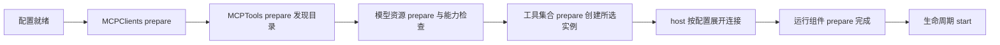
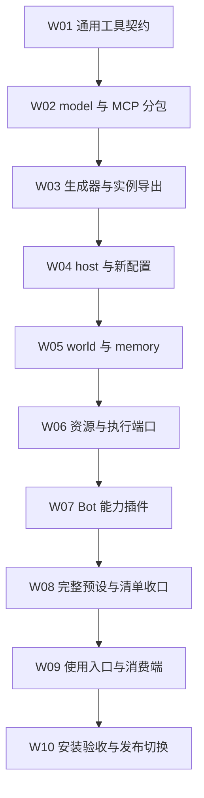

# 插件体系新基线实施计划

本计划依据[能力归属与拆分方案](plugin-capability-boundaries.md)和[插件元信息与集中装配方案](aurora-meta-proposal.md)，将包拆分、元信息、实例导出与产品装配作为一次完整的基线切换。代码起点为 `d6217150`，能力清点见 `07ddadd5` 的拆分文档。本文是后续实施清单，本次只新增计划文档。

**直接切换到新基线，不提供旧包、旧入口、旧 ID、旧配置或旧快照的兼容实现。** 开发过程可以小步提交，交付时只有一种声明来源、一种宿主装配入口和一套默认接线。实现以信任开发者为前提，沿用已有执行与资源管理语义，不增加防御性框架。

阅读入口：[固定决策](#1-固定决策)、[目标归属](#2-目标包与插件)、[身份和配置切换](#3-公共身份与配置切换)、[装配协议](#5-实例导出和集中装配)、[实施任务](#7-实施任务与完成条件)、[验收](#8-验证与交付)。

## 1 固定决策

### 1.1 本计划对两份方案的收敛

| 议题         | 新基线决定                                                          | 被取代的安排                               |
| ------------ | ------------------------------------------------------------------- | ------------------------------------------ |
| 包与公共身份 | 按新能力归属修改 import、发行依赖、插件名和公共 ID                  | 搬包后继续保留旧命名空间，或增设兼容转发包 |
| 清单粒度     | 每个公开逻辑插件一份 `plugin.meta.toml`；同一发行包构建时汇总目录   | 每个发行包只能有一份清单                   |
| 插头定义     | `@plug(生成 ID)` 只关联实现；定义不含目标槽                         | 旧 `hook_handler(slot=...)` 与新声明并行   |
| 运行装配     | 宿主只执行明确选定的 assembly 计划                                  | 同时维护代码装配 ID 和文件装配两条宿主路径 |
| 执行连接     | 用真实 ExecutionPlug/ExecutionSlot 建立业务连接                     | 将执行端口降级成无参方法，或另造执行协议   |
| 业务订阅     | 私有 ctx 订阅、算法、选择器保留在插件代码                           | 把所有内部动作写成配置表达式或全局事件路由 |
| 配置模板     | 一次切换到 `plugin.config.toml` 或 `plugin.config.tomls/`           | 同时探测新旧模板名                         |
| 用户数据     | 新安装环境和新数据目录；配置按新模板重新建立                        | 自动改写旧 TOML、旧快照或旧记忆库          |
| 协议版本     | 本次清单、目录和装配结构统一使用 `schema_version = 2`，仅实现这一版 | 版本转换器、多版本 reader 和旧格式降级     |
| 实施方式     | 同一实施分支按工作包提交，完整切换后合并与发布                      | 为维持每个中间提交可发布而增加临时兼容接口 |

schema_version 只标识文件结构，不承担数据迁移。保留归属未变的公共 ID 是命名本身仍合适，不意味着支持旧版本运行图。

### 1.2 不做防御性编程的具体含义

实现直接使用明确的导出协议、字典查找、既有 registry 和连接方法。缺少对象、配置无法解析、执行失败时，由实际消费处报告错误并保留来源；不包成“可继续运行”的空对象，不吞掉异常，不猜测替代插件。

不新增权限审批、沙箱、构造函数扫描、任意对象反射注入、全局 schema 兼容推理、每次调用的重复校验、自动依赖启用、旧格式探测和自动重试。公开资源关系使用直接引用，不增加万能代理、兼容适配层或服务定位器。

已有的取消等待、任务收尾、资源关闭、配置解析、协议错误处理和工具参数语义属于功能行为，迁移时保留。它们不是本次为了假设性风险新加的防御代码；也不借“去防御”改变调用完成、取消或资源所有权的约定。

## 2 目标包与插件

### 2.1 运行包

下表确定目标位置。目录中的新文件在对应工作包创建，不要求先提交空包或空框架。

| 目标包           | 从哪里取得实现                                   | 对外能力与插件                                                                                                              | 依赖约束                                                                          |
| ---------------- | ------------------------------------------------ | --------------------------------------------------------------------------------------------------------------------------- | --------------------------------------------------------------------------------- |
| `aurora_core`    | 现有 core                                        | registry、ctx、hook、生命周期、存储、纯声明与组件导出；无伪造的 core 插件                                                   | 不依赖 config/control/host                                                        |
| `aurora_control` | 现有 control                                     | ExecutionRequest/Plug/Slot、状态绑定、五种控制组件；保留 `aurora_control`                                                   | 仅 core                                                                           |
| `aurora_config`  | 现有 config，移出 host/assembly 和构建工具       | 配置声明、schema、模板、加载/编辑；保留 `aurora_config`                                                                     | core 与现有 schema 库                                                             |
| `aurora_host`    | CLI host、宿主引导、config 中的 AssemblyPlan     | 普通宿主库、应用计划解析、实例装配和运行图；无业务插件                                                                      | core/config/control；不导入 agent/bot/MCP/模型                                    |
| `aurora_tools`   | agent/tools.py；model/contract.py 中通用工具数据 | ToolDefinition、ToolCall、ToolSpec/Factory/Instance、ToolExecutor 与目录；`aurora_tools`、可选 `.configuration`             | 基础 core/control 与工具 schema 库；配置 extra 使用 config；不导入 model/agent    |
| `aurora_model`   | adapter/model                                    | 模型协议、目录与资源组件，配置，LiteLLM；`aurora_model`、`.configuration`、`.litellm`                                       | 基础使用 core/tools；config、供应商 SDK 按 extra                                  |
| `aurora_mcp`     | adapter/mcp，移出 bot.py                         | 客户端与目录；`aurora_mcp`、`.tools`、`.world`                                                                              | core/config/MCP SDK；tools/world 桥按 extra；不导入 bot                           |
| `aurora_agent`   | 现有 agent，移出 tools                           | ReAct、ModelCall、默认阶段、AgentRuntime、预算和压缩；保留 `.model`、`.react`、`.react_defaults`，新增可选 `.configuration` | 基础 core/control/model/tools；配置 extra 使用 config；无供应商 SDK、bot、CLI/API |
| `aurora_world`   | 现有 world                                       | `aurora_world.records`、`.sources`、`.configuration`、`.environment`                                                        | 基础 core；config/环境来源依赖按 extra                                            |
| `aurora_memory`  | bot/memory                                       | 记忆存储与五种工具；`aurora_memory`、可选 `aurora_memory.compaction`                                                        | core/config/model/tools；压缩桥 extra 才依赖 agent                                |
| `aurora_bot`     | 现有 bot，移出 memory，拆开 assembly             | runtime、conversation、commands、notes、actions、self_control、world_view、cadence 八个插件，以及产品预设                   | 基础使用 agent/config/core；world/MCP/memory/供应商按功能 extra                   |
| `aurora_cli`     | 现有命令、解析、交互；移出通用 host              | CLI 内部命令、开发命令、静态目录与图查询                                                                                    | host/logging；serve 使用 API extra                                                |
| `aurora_api`     | 现有 API                                         | HTTP/WS、访问策略、端点目录；保留 `aurora_api`                                                                              | core/aiohttp；不导入 bot                                                          |
| `aurora_logging` | 现有 logging                                     | 普通日志库                                                                                                                  | 保持独立，不制造插件                                                              |

模型协议引用 tools 的中立数据模块；该模块只使用 core 的 JSON 类型。工具执行器不反向引用模型。tools 与中立数据暂同一发行，因此安装 model 会传递安装 tools/control；不为消除这一轻量依赖再拆一个只有类型的发行包。

`aurora_adapter` 最终删除，不能成为同时转发 model 和 MCP 的空壳。根 `aurorabot-ai` 是默认产品的安装集合：默认只包含正式 onboarding 所需的 CLI、API、ReAct、LiteLLM 和 terminal MCP；world/environment、memory、cadence 决策能力通过产品 extra 选择。

### 2.2 Bot 插件的定义与资源分配

| 新插件                    | 当前定义与实现的去向                                                                                   | 显式资源关系                                                         |
| ------------------------- | ------------------------------------------------------------------------------------------------------ | -------------------------------------------------------------------- |
| `aurora_bot.runtime`      | AGENTS/MESSAGES/RUN/WORK、run_control 服务、三个运行 operation；operations.py 及 assembly 中的运行部分 | 持有唯一 AgentRuntime，绑定一个 agent；负责停止接收与等待运行结束    |
| `aurora_bot.conversation` | conversation.py、conversation_contract.py、attachments.py、conversation endpoint                       | 引用 runtime 与产品消息状态                                          |
| `aurora_bot.commands`     | cli.py 中 submit/activate/cancel 的 command 声明                                                       | 消费运行 operation，不再创建宿主或执行机制                           |
| `aurora_bot.notes`        | work_notes.py、notes 状态、notes component 和三个工具                                                  | 笔记 owner 与工具 input/output 由装配传入                            |
| `aurora_bot.actions`      | action_evidence.py、actions/read component/tool                                                        | 暴露 recorder 与观察转换服务，供工具执行器和默认阶段引用             |
| `aurora_bot.self_control` | self_control.py、self_control_state.py、六个工具                                                       | 引用唯一 runtime；计划与自主状态由自身维护                           |
| `aurora_bot.world_view`   | context_view.py、event_archive.py、world/read_event component/tool                                     | 引用 records；不创建或关闭 records/sources                           |
| `aurora_bot.cadence`      | cadence 目录、其状态与配置                                                                             | 引用 runtime、records、self_control 和按需 choice 资源；保留内部订阅 |

`DefaultAssembly` 不对应一个新名字的大工厂。其职责逐项分配到上表、model 资源、tools 工具所有者、memory、world 和预设；分配完成后删除 assembly.py 的旧装配实现。

### 2.3 构建工具与非 Python 消费者

通用元信息生成器放到 `tooling/aurora_meta_build/`，作为纯构建依赖发行 `aurora-meta-build`。它从当前 config/build_meta.py 提取，不依赖任何 Aurora 运行包，不成为宿主安装依赖。多个发行包和隔离 sdist 构建都是它的实际消费者；构建钩子通过声明的 build-system 依赖使用它，不向上搜索工作区脚本。

`aurora_client`、Panel、TUI 继续消费传输契约和 ctx。同步更新公共 ID、配置入口与生成契约，不在 TS 侧复制 Python 的插件装配器。docsite 更新架构和使用文档；landing 只检查是否含有需要更新的安装命令。

## 3 公共身份与配置切换

### 3.1 全部旧公开插件的去向

| 旧入口                        | 新入口或去向                                                         |
| ----------------------------- | -------------------------------------------------------------------- |
| `aurora_config`               | 同名；通用装配移至 host                                              |
| `aurora_control`              | 同名                                                                 |
| `aurora_adapter.model`        | `aurora_model`、`aurora_model.configuration`、`aurora_model.litellm` |
| `aurora_adapter.mcp`          | `aurora_mcp`                                                         |
| `aurora_adapter.mcp.tools`    | `aurora_mcp.tools`                                                   |
| `aurora_adapter.mcp.world`    | `aurora_mcp.world`                                                   |
| `aurora_adapter.mcp.bot`      | 删除入口；组合进入 Bot 的 MCP 预设                                   |
| `aurora_agent.model`          | 同名                                                                 |
| `aurora_agent.react`          | 同名                                                                 |
| `aurora_agent.react_defaults` | 同名，删除自动 connect                                               |
| `aurora_agent.tools`          | `aurora_tools`                                                       |
| `aurora_world`                | `aurora_world.records`、`aurora_world.sources`                       |
| `aurora_world.configuration`  | 同名，requires 按 records/sources 的实际引用调整                     |
| `aurora_world.environment`    | 同名，依赖来源协议对应的插件                                         |
| `aurora_bot.assembly`         | 删除入口；定义拆入第 2.2 节七个新插件，组合进入预设                  |
| `aurora_bot.cadence`          | 同名，依赖 runtime 等能力，不依赖 assembly                           |
| `aurora_bot.memory`           | `aurora_memory`；压缩组合由 `aurora_memory.compaction` 提供          |
| `aurora_api`                  | 同名                                                                 |

每个目标 entry point 的名称和工厂路径只写在所属 pyproject.toml。清单引用名称，生成 Plugin.name；requires 只写在清单，并按实际消费的定义填写。没有旧名称别名，也不根据 import 依赖自动填 requires。

### 3.2 公共 ID 的确定规则

对拆分文档附录 A 的 145 个当前定义逐项应用下表。表是开发时的去向说明，不生成运行时迁移映射。

| 当前范围                                                              | 新基线规则                                                                                                                                                                                  |
| --------------------------------------------------------------------- | ------------------------------------------------------------------------------------------------------------------------------------------------------------------------------------------- |
| `org.aurora.adapter` 下 model 定义                                    | 命名空间改为 `org.aurora.model`，各 domain 下去掉首段 `model/`；例如 `adapters/model/litellm/chat` 变为 `adapters/litellm/chat`                                                             |
| `org.aurora.adapter` 下 MCP 定义                                      | 命名空间改为 `org.aurora.mcp`，各 domain 下去掉首段 `mcp/`；例如 `components/mcp/tool/execute` 变为 `components/tool/execute`；`configs/mcp` 改为 `configs/default`                         |
| 动态 `org.aurora.adapter:tools/mcp/<name>`                            | 改为 `org.aurora.mcp:tools/<name>`；引用和动态选择同时切换                                                                                                                                  |
| `org.aurora.agent:registries/tools`                                   | `org.aurora.tools:registries/tools`                                                                                                                                                         |
| `org.aurora.agent:handlers/react/execute_tools` 及其 execute/children | `org.aurora.tools:components/executor` 及其 execute/children                                                                                                                                |
| `org.aurora.agent:tools/before_call`、`tools/after_call`              | `org.aurora.tools:executor/before_call`、`executor/after_call`                                                                                                                              |
| bot memory 的 config/state/component/tool 及 execute                  | 命名空间改为 `org.aurora.memory`；`configs/memory`→`configs/default`、`state/memory/config`→`state/config`、`components/memory`→`components/tool`、`tools/memory/<action>`→`tools/<action>` |
| `org.aurora.bot:configs/default`、`state/config`                      | 删除这两个大配置定义；按下节拆为各实际消费者的配置和非持久状态                                                                                                                              |
| 两个旧 `assemblies/...` 定义                                          | 删除，预设是资源文件，不再登记代码 assembly 工厂                                                                                                                                            |
| `org.aurora.bot:handlers/assembly/*` 六个生命周期处理器               | 删除；所归属资源组件导出自己的生命周期插头，不建立一一兼容转发                                                                                                                              |
| 其余 core/config/control/agent/world/Bot/API 定义                     | 归属包未变，保留有明确业务含义的 ID；归属插件按第 2 节调整                                                                                                                                  |

新增生命周期 ID 采用 `org.aurora.<包>:handlers/<能力>/<阶段>`，例如 `org.aurora.model:handlers/chat/prepare`、`org.aurora.model:handlers/chat/clean`。新增配置 ID 使用 `configs/<能力>`，对应非持久配置键使用 `state/<能力>/config`。

provider 统一使用定义所属的完整 Plugin.name，由生成器从 entry point 引用取得，不手写第二套 provider。component ID 与 `/execute` 仍是两个定义；它们只在清单定义，类的 definition_id 和导出方法都引用生成常量。

旧 ID 在源码中的有效使用、默认配置、TS 生成物和测试断言一并更新。历史说明可以记录旧名字，但运行代码和正式示例不查找、接受或转换它们。

### 3.3 配置分配与模板

| 当前配置内容                                                               | 新归属                                                                                                           |
| -------------------------------------------------------------------------- | ---------------------------------------------------------------------------------------------------------------- |
| `host.toml` 的 plugins、assembly ID、assembly_file 混合选择                | 只保留 assembly_file 作为运行拓扑选择；插件列表在 assembly 中                                                    |
| Bot instance_id、tools 列表、notes/archive/actions/self_control 等启用开关 | 实例表、工具集合与显式插件选择；从业务配置删除                                                                   |
| Bot 模型角色、MCP 工具追加规则、world 来源工厂替换                         | 模型资源实例的配置引用、动态工具集合规则、资源引用                                                               |
| Bot max_iterations、输入预算、压缩参数、输出限制等业务参数                 | 按下表归 agent.configuration、tools.configuration 和 Bot 能力的 ConfigSpec；不再通过 BOT_CONFIG 整体传入所有组件 |
| 模型 profiles/bindings                                                     | model.configuration，配置与资源角色绑定分开                                                                      |
| MCP 连接和目录过滤                                                         | aurora_mcp；应用是否采用某目录仍由 assembly 决定                                                                 |
| cadence、memory、world 来源参数                                            | 对应能力配置，独立模板和非持久配置键                                                                             |
| CLI 输出与交互参数                                                         | aurora_cli，自身配置与 host 引导分开                                                                             |

配置声明按实际消费者进一步确定，避免把旧 BOT_CONFIG 换名后继续作为公共依赖：

| 原字段或参数                                     | 唯一配置拥有者与目标 config ID                                               |
| ------------------------------------------------ | ---------------------------------------------------------------------------- |
| max_iterations                                   | `aurora_agent.configuration` · `org.aurora.agent:configs/react`              |
| streaming                                        | 同上 · `org.aurora.agent:configs/model_call`                                 |
| system_prompt                                    | 同上 · `org.aurora.agent:configs/react_defaults`                             |
| input_budget.max_chars                           | 同上 · `org.aurora.agent:configs/input_budget`                               |
| context_management 的摘要长度、超时与观察限额    | 同上 · `org.aurora.agent:configs/compaction`；需要同一限额的消费者引用同一项 |
| tool_timeout                                     | `aurora_tools.configuration` · `org.aurora.tools:configs/executor`           |
| actions.max_chars                                | `aurora_bot.actions` · `org.aurora.bot:configs/actions`                      |
| context_view 的内容选择与长度、archive.max_chars | `aurora_bot.world_view` · `org.aurora.bot:configs/world_view`                |

agent/tools 的 configuration 是同发行包内的可选配置桥，requires 指向 config 和实际消费能力；基础协议与执行插件不强制依赖配置服务。这是对能力方案配置归属的补全，不新增发行包。配置状态使用对应 `state/<能力>/config`，通过 instance.states 中的配置角色注入；工厂仍可供程序化消费者使用显式参数。一个被装配实例选择一种参数来源，不混合隐式默认覆盖链。

input_budget、compaction、context_view 等 `enabled` 只涉及是否创建/绑定该服务时，删除开关，改由实例与资源引用决定。max_chars 等行为参数保留为配置。共享资源被多个实例引用时仍只有一个配置拥有者，不复制多份限额或 schema。

每个插件的模板资源与清单、实现相邻。单文件为 `plugin.config.toml`，多文件为 `plugin.config.tomls/`；ConfigTemplate 只实现新命名。同一资源模块选择一种形式，不同时放两套模板。用户数据目录中的文件路径由 ConfigSpec/ConfigTemplate 的 owner 和资源映射确定，不要求所有用户文件都叫 plugin.config.toml。

应用拓扑只有 assembly 一处。业务 TOML 不再通过 `enabled` 一类字段偷偷创建插件实例。运行参数仍由 TOML 加载到非持久 ctx，配置编辑端点沿用对应声明；凭证由运行期解析器提供，不写入清单、快照或模板。

### 3.4 新环境和数据

实施与验收使用独立虚拟环境、独立 data 目录及新生成的配置。旧环境中卸载残留发行包不是新运行时的职责；发布说明直接要求重新建立环境。

旧快照、记忆 SQLite、模型指纹和用户配置不纳入新基线恢复承诺。不编写转换脚本，不自动读取旧目录，不删除或覆盖旧数据。恢复测试改为“新基线写入、新基线恢复”，仍验证有效状态、取消和不自动续跑的既有语义，不通过忽略未知状态让旧数据假装兼容。

## 4 元信息与生成规则

### 4.1 文件组织

```text
packages/aurora_model/
  pyproject.toml
  plugin.meta.json                  生成的发行目录
  src/aurora_model/
    contract.py
    plugins/
      model/
        __init__.py
        plugin.meta.toml
        _meta.py                    生成的声明与 ID
      configuration/
        __init__.py
        plugin.meta.toml
        plugin.config.tomls/
        _meta.py
      litellm/
        __init__.py
        plugin.meta.toml
        _meta.py
```

其他多插件发行包按同样规则组织。单插件包在其实现根目录放清单与 `_meta.py`。pyproject 的构建配置只列清单路径与生成模块位置，不重复公共 ID、插件说明或连接。

保留元信息方案已有的 plugins、definitions、components、contracts、dynamic 区域；一份文件只描述一个公开插件。components 扩展导出的业务槽、资源名、状态角色和工厂参数契约，具体接口在 W03 用 control 与 model/tools 的真实消费者落实。

### 4.2 单一来源

| 信息                                                      | 编辑来源                     | 消费方式                               |
| --------------------------------------------------------- | ---------------------------- | -------------------------------------- |
| 安装依赖、extra、版本、entry point 工厂                   | pyproject.toml               | 构建目录合并标准发行信息               |
| 公共定义 ID、kind、用途、register_to、interface、requires | plugin.meta.toml             | 生成常量、声明与静态目录               |
| 方法与插头 ID 的关联                                      | `@plug(生成 ID)`             | 显式工厂导出；不扫描模块               |
| 实例槽和资源对象                                          | 工厂显式导出函数             | 以生成 ID 或清单资源名索引实际对象     |
| 数据结构和配置 schema                                     | 单个 schema 文件或纯导出函数 | 运行消费者、静态目录和 TS 生成共用     |
| 实例、资源引用、状态地址、优先级、生命周期依赖            | 一份被选定的 assembly.toml   | host 建立对象与接线                    |
| 用户配置值                                                | 对应 TOML                    | config 注入非持久状态                  |
| 动态工具定义                                              | MCP prepare 发现的目录       | 选定集合展开实际实例，目录输出记录来源 |

core 的 bootstrap ID 仍由 core 定义并纯导出到宿主目录，不复制成一个需要启用的插件。CLI 九个内部命令插件继续按自身声明机制提供命令；命令契约从其声明纯导出到宿主目录，不为它们添加第二套 `aurora.plugins` 入口。公开 Bot 命令则随其公开插件迁移清单。

### 4.3 构建产物与开发入口

构建工具提供两个操作：生成全部选中清单的 `_meta.py` 与发行 `plugin.meta.json`；只读检查产物是否与来源一致。Python 按 AST、JSON 按数据比较，生成结果不手工维护。

wheel 保留 `.dist-info/extra_metadata/plugin.meta.json`；多清单以相对来源路径区分本地符号，公共检索按 entry point 和完整 ID。不能把不同插件的同名 `CONFIG` 符号平铺成一个映射。源清单和契约来源随 sdist 分发；wheel 包含运行所需模板、预设和生成模块。

纯契约导出继续不启动业务资源。开发者负责导出函数的行为，工具直接执行并报告异常，不引入沙箱。静态查询只读取发行目录，不导入插件；发布构建只检查生成物，不悄悄改写源码。

为支持隔离构建，先构建并安装/发布 `aurora-meta-build`，再构建运行包。构建测试包含从 sdist 在工作区之外构建 wheel；不能依赖仓库相对路径、当前 editable 安装或已导入的供应商 SDK。

## 5 实例导出和集中装配

### 5.1 最小实例协议

扩展现有 ComponentFactory/ComponentExport，不另建执行框架。工厂协议确定为以下职责；具体类型放在 core 的纯导出层，执行端口的类型仍由 control 提供。

| 工厂入口或结果 | 职责                                                                                      |
| -------------- | ----------------------------------------------------------------------------------------- |
| create         | 同步创建实例；接收明确列出的宿主服务、instance_id、参数和状态角色；不启动网络、线程或任务 |
| export         | 显式返回该对象的插头、槽、资源映射；键为生成 ID 或清单资源名；不扫描属性和方法            |
| bind           | 在所有静态实例创建后，接收 assembly 明确引用的资源；只绑定对象，不连 hook、不启动资源     |
| stop_accepting | 保留现有本地停止接纳回调；没有这项职责的组件不填                                          |
| 生命周期插头   | config/prepare/start/stop/clean 中实际需要的方法，用 `@plug` 导出，连接写入 assembly      |

create → export → bind 是固定的装配过程，不是任意依赖注入容器。先创建全部静态对象再绑定直接引用，允许 runtime 与 self_control 等在对象层互相引用；启动资源的先后仍只看 depends_on。没有资源引用的工厂无需 bind。

资源导出的是稳定的能力对象或资源所有者，例如 ChatResource、WorldRecords、AgentRuntime 所属运行服务。网络客户端可以在 prepare 后写入资源所有者的字段，消费者在约定阶段借用；不在构造阶段解析“尚未创建的客户端”，也不使用万能延迟代理。每个资源只由其所有者关闭。

业务插头导出实际 ExecutionPlug，业务槽导出实际 ExecutionSlot。工厂从装饰器取得执行方法身份，从清单取得组件与端口身份；不再在 component_entries 中拼接并重复登记已由清单定义的公开端口。内部临时执行函数仍可使用 control 的程序化接口。

### 5.2 assembly 的字段边界

| 区域                    | 内容                                                               | 谁解释                                       |
| ----------------------- | ------------------------------------------------------------------ | -------------------------------------------- |
| schema_version、plugins | 格式及明确启用列表                                                 | host                                         |
| instances               | plugin、component、depends_on                                      | host                                         |
| instance.options        | 工厂需要的简单构造选择，例如模型 role、数据 owner                  | 相应工厂；宿主只传值                         |
| instance.resources      | `{ instance, export }` 的直接对象引用                              | host 查找导出；消费者按协议使用              |
| instance.states         | 角色到 `{ key, location, scope }` 的绑定；scope 为 instance 或 run | host 构造 control 的状态绑定；消费者解释角色 |
| connections             | 插头/槽的完整定义 ID、实例 ID、priority                            | host 调用底层连接方法                        |
| 工具集合实例的 options  | 静态工具选择或动态目录筛选、实例命名规则                           | tools 的工具集合组件                         |
| 集合连接                | 源集合导出到一个明确槽的展开规则                                   | host 执行；与普通 connections 同属所选装配   |

资源引用不允许任意 Python import 路径、属性链或表达式。slot 的业务意义仍由提供方解释，不从 schema 推导执行顺序。生命周期方法使用 HookConnections；E 端口使用 ExecutionSlot.connect，保留 ExecutionLink 的状态地址握手。

以下是新格式的**局部规格示例**，展示状态和资源引用；完整产品实例及生命周期连线在 W08 写成可执行预设。当前版本不执行这段新格式。

```toml
schema_version = 2
plugins = ["aurora_agent.model", "aurora_agent.react"]

[instances.model_call]
plugin = "aurora_agent.model"
component = "model_call"

[instances.model_call.resources]
chat = { instance = "chat", export = "model" }

[instances.model_call.states.input]
key = "org.aurora.bot:state/react_work"
location = { instance_id = "onboarding", part = "model_input" }
scope = "run"

[instances.model_call.states.output]
key = "org.aurora.bot:state/react_work"
location = { instance_id = "onboarding", part = "model_output" }
scope = "run"

[[connections]]
plug = { instance = "model_call", id = "org.aurora.agent:handlers/model_call/execute" }
slot = { instance = "react", id = "org.aurora.agent:react/infer" }
priority = 0
```

上述 chat、react 以及 Bot 状态定义由完整预设显式选择；片段没有暗示宿主会补齐它们。instance_id、定义 ID、run_id、execution_id 分别管理；scope=run 只增加 run_id，不自动把 execution_id 当作数据位置。

### 5.3 配置与启动顺序

1. host 读取唯一选定的 assembly，发现其 plugins；登记 core 自举定义、生命周期槽和所选插件定义。
2. 创建 ctx、storage、hooks；按工厂 create/export 创建全部静态实例，再按 resources/states 完成绑定。
3. 按 connections 建立静态连接，使用 depends_on 创建生命周期组件。配置服务必须在实例表中明确出现。
4. 恢复新基线业务状态；运行整个 config 阶段。配置服务先加载声明，其他组件再应用自身配置。
5. 运行 prepare，依次准备共享资源、目录、工具集合和业务组件；动态集合在所属 prepare 中完成展开，见下节。
6. 所有 prepare 完成后进入 start。运行入口开始接纳任务；来源和 cadence 按声明顺序启动。
7. 关闭时先停止接纳，等待正在执行的工作，按生命周期逆序停止消费者并释放所有者资源，最后宿主落盘和关闭。

保留 core 的五个阶段和当前失败收尾行为，不增加“第六阶段”。构造依赖、生命周期依赖、运行连接和插件 requires 不互相猜测。

### 5.4 静态和动态工具集合

工具集合组件归 `aurora_tools`，是 ToolSpec 的通用实例所有者。静态工具和 MCP 发现工具都走同一套 ToolFactory/ToolInstance 创建与关闭逻辑，Bot 不再自己实现一套工具装配。

ToolFactory 增加明确的 resources 输入，由工具选择项或集合引用指定所需服务，例如 notes、runtime、memory、MCPClients；input/output 继续使用显式状态绑定。工具工厂直接使用收到的对象，插件登记后的 ToolSpec 不再被 Bot 替换 factory。SourceFactory 同理接收来源选择的资源引用，MCP world 不再替换全局 SourceSpec 来注入客户端。

MCPTools.prepare 只取得目录、生成动态 ToolSpec；工具集合 prepare 按装配指定的目录、include/exclude 和名称规则选择工具，创建实例并保存 ToolInstance.aclose。目录来源、选择规则、input/output 地址规则和目标槽都必须来自该集合的装配描述。

动态成员不能在 import 或初始静态连接时创建出来。host 给集合组件注入一个小范围的 `publish_members` 回调：集合准备完实例后提交实例 ID 和导出端口，host 按预先读取的集合连接规则调用 ExecutionSlot.connect 并记录实际边。回调只处理该次启动的集合展开；不实现热加载、自动重连、无限递归集合或全局事件总线。工具实现本身不知道目标槽。

集合组件的 prepare 只有在成员创建和接线完成后才结束。出现错误就按既有资源所有权收尾并传播，不重试、不忽略某个失败工具继续启动。模型能力检查需要的工具说明从目录和选择结果取得，不要求先执行工具。



图表示启动依赖，不是 hook 插入方向。没有 MCP 时静态工具目录直接参与相同的选择与创建过程。集合只借用 MCPClients、模型、notes、memory 等服务；不重复关闭这些资源。

### 5.5 新基线的默认执行图

默认预设使用 `react`、`model_call`、`tools`、`defaults`、`runtime` 等明确实例别名。业务数据 owner 使用预设中的 `onboarding` 或用户给定实例名，不再依赖 A/default 与 B/main 两套字符串拼接。

| 插头实例与定义                                                          | 槽实例与定义                                            | priority |
| ----------------------------------------------------------------------- | ------------------------------------------------------- | -------- |
| defaults · `org.aurora.agent:handlers/react/build_prompt/execute`       | react · `org.aurora.agent:react/prepare`                | 10       |
| model_call · `org.aurora.agent:handlers/model_call/execute`             | react · `org.aurora.agent:react/infer`                  | 0        |
| defaults · `org.aurora.agent:handlers/react/interpret_response/execute` | react · `org.aurora.agent:react/infer`                  | 10       |
| tools · `org.aurora.tools:components/executor/execute`                  | react · `org.aurora.agent:react/act`                    | 0        |
| defaults · `org.aurora.agent:handlers/react/record_observation/execute` | react · `org.aurora.agent:react/observe`                | 10       |
| 每个选定工具实例的 execute                                              | tools · `org.aurora.tools:components/executor/children` | 0        |

defaults 一个实例导出三个不同插头；无需为了端口数量创建三个相同的服务对象。finish/error 和 tools before_call/after_call 默认仍不连接处理器。目标图改变接线来源与身份，不改变五条默认阶段连接的业务顺序。

AgentRuntime 调用 agent、ModelCall 使用 ChatClient、压缩器调用 memory recorder、cadence 订阅 ctx、API 调用 endpoint 仍是直接协议协作；资源引用进入装配视图，不为绘图或统一外观添加假插槽。

## 6 预设与使用入口

### 6.1 只有一种宿主入口

保留 `--assembly-file PATH` 和 host.toml 的 `assembly_file`。删除旧 `--assembly`、装配 ID 参数、host.plugins、独立 `--plugin` 叠加和旧代码 assembly 工厂分派。两个文件选择方式只是同一 reader 的参数来源：命令行优先，host 文件相对路径按其所在目录解析。

程序化用户可以直接构造同一 AssemblyPlan 并交给 host，不另保留 DefaultAssembly 作为第二条产品执行入口。core/control 的低层程序化使用继续存在；它们不自动补入 Bot 产品图。

host 不依赖 CLI CommandContext。宿主提供 registry/ctx、所装配实例、Lifecycle 和图查询；CLI 自己解析命令并在宿主范围内执行。API 服务通过明确的 serve 入口启动，启用端点目录不代表启动监听。

### 6.2 产品预设与用户文件

Bot 包发布 `presets/default/assembly.toml`、`presets/mcp/assembly.toml`、`presets/onboarding/assembly.toml`。每个最终预设都是一份展开后的完整图，不在运行时做预设继承或多文件叠加。共享生成材料可以在开发期复用，生成后的运行选择仍只有一份文件。

首次安装助手把选定预设复制到新数据目录的 `config/assembly.toml`，并写入 `config/host.toml` 的 assembly_file；之后该用户文件是拓扑的唯一来源。宿主不再叠加包内默认连接，也不根据已安装插件补实例。工具和插件的功能参数通过各自新模板初始化。

onboarding 保持朴素 ReAct + terminal MCP 的产品范围，不默认启用 world、cadence、memory、QQ 或决策模型。需要这些能力时给出明确的附加组合说明或完整可选预设；不恢复靠配置字段隐藏装配的做法。

### 6.3 能力、计划图与实际图

| 查询入口                                    | 数据来源                 | 应显示什么                                                 |
| ------------------------------------------- | ------------------------ | ---------------------------------------------------------- |
| `aurora plugin list` / `aurora plugin show` | 已安装发行包中的静态目录 | 包、entry point、定义、端口契约、所需 extra、动态集合说明  |
| `aurora assembly plan`                      | 所选装配文件与静态目录   | 明确实例、资源和状态绑定、静态连接；动态集合显示待展开规则 |
| `aurora assembly graph`                     | 已完成启动的当前宿主     | 实际实例、端口连接、动态成员、生命周期依赖与资源 owner     |

以上为待实现的命令名。计划图查询不构造模型或 MCP 客户端；实际图查询走正常宿主启动，不能用静态目录冒充。先提供 JSON 输出和可读文本/Mermaid 导出，Panel/TUI 本轮只消费更新后的 ID 与契约，不把新建图编辑器列为交付条件。

图的内部记录来自工厂导出、实际 connect 和 publish_members 的结果；不能再维护一套与运行对象独立的“展示接线表”。无需在线重装配或观察任意插件内部 Python 调用。

## 7 实施任务与完成条件

工作包按下图推进。可以在一个工作包内小步提交；每次搬动同步修改该能力的消费者，不靠转发模块维持导入。W01—W09 的中间状态不是独立发布基线，最终通过 W10 后统一切换。



### W01 提取通用工具与中立数据

**改动范围：** [agent/tools.py](../packages/aurora_agent/src/aurora_agent/tools.py)、[model/contract.py](../packages/aurora_adapter/src/aurora_adapter/model/contract.py)、[core JSON](../packages/aurora_core/src/aurora_core/json_data.py)、新 `packages/aurora_tools`，以及所有工具消费者。

- 将 JsonValue 归入 core 的 JSON 能力；ToolDefinition、ToolCall 归 tools 中立契约模块。模型消息、MCP、工具执行与 Bot 改为引用同一份类型。
- 将 ToolSpec、ToolFactory、ToolInstance、ToolExecutor、工具目录、before/after、工具结果与批次数据移到 tools；ReAct 历史解释留在 agent 默认阶段。
- 按第 3.2 节切换 tools 的公共 ID；agent、MCP、memory、notes/actions/self_control、测试与夹具同时改引用。
- 更新根 workspace/sources、包依赖、覆盖率目录、类型检查路径和锁文件。agent 不再导出工具类型；删除旧 agent.tools 模块和入口。
- 将现有工具单测搬到新包，不复制两套测试；执行契约测试继续由 control 负责。

**完成条件：** 在没有 model、agent、Bot、供应商 SDK 的环境中，用假工具完成一次 ToolExecutor 调用；before/after 与正常结果语义保持。代码依赖不存在 tools→model 或 tools→agent。

### W02 拆开 model 与 MCP 的发行边界

**改动范围：** [adapter 包](../packages/aurora_adapter/)、新 `packages/aurora_model`、`packages/aurora_mcp`、Bot 产品预设来源。

- model 目录整体归 model 包；将协议/目录、配置声明、LiteLLM 分成三个逻辑插件和可选依赖。testing 中的假模型随协议测试迁移。
- MCP 客户端、传输、配置、目录和工具/world 桥归 MCP 包；tools/world 的 import 与 extra 分开。
- 将 MCP Bot 的产品选择移到 Bot 侧待编排材料，不把 DefaultAssembly 或 Bot import 带入新 MCP 包。
- 按第 3.2 节更新公开 ID、动态工具 ID、模型角色绑定、凭证引用消费者、测试夹具、根安装集合和 lock。
- 删除 adapter 的发行声明、源码目录及 workspace 配置；删除纯旧格式转换逻辑，例如仅为旧 MCP 配置迁移服务的 migrate 代码，仍在使用的协议解析职责直接归当前配置模块。

**完成条件：** 新 model 基础包可导入协议而不导入 LiteLLM；新 MCP 客户端不安装 Bot；两个桥分别按 extra 独立安装。代码中没有运行用的 `aurora_adapter` import 或旧 entry point。

### W03 提取生成器并完成真实实例导出

**改动范围：** [core/components.py](../packages/aurora_core/src/aurora_core/components.py)、[core/declarations.py](../packages/aurora_core/src/aurora_core/declarations.py)、[config/build_meta.py](../packages/aurora_config/build_meta.py)、[构建钩子](../packages/aurora_config/hatch_build.py)、新 `tooling/aurora_meta_build`。

- 把生成器提取为不依赖运行包的构建工具，加入 workspace 的构建开发依赖；支持多清单、独立符号空间、版本 2 目录和每清单生成模块。
- 按第 5.1 节补齐 create/export/bind、业务槽与资源显式导出，保留现有 `@plug` 的方法身份语义；core 不导入 control。
- 清单记录组件状态角色、资源导出/输入名和参数契约；Python 提供实际对象与行为。显式导出缺项在绑定处直接报错，不扫描对象补齐。
- 用 config 的真实服务和 control 的真实 Serial 组件完成首条方法端口、执行端口两类导出。再用 ModelCall 的资源需求检验 bind，无需构建假的“通用业务插件”。
- config 清单迁到实现旁，重生成 `_meta.py` 与发行目录；各构建钩子只调用同一生成器，不保留包内生成算法副本。
- 扩展现有 [元信息契约测试](../tests/contract/test_plugin_metadata.py)，覆盖同发行多插件、真实槽导出、无 SDK 静态读取和 sdist 构建输入；不逐字段堆叠重复测试。

**完成条件：** 生成、只读核对、静态查询可用于多个发行包；control 的 Slot/Plug 对象经导出后仍可完成状态握手。生成过程不导入模型或 MCP 实现。

### W04 提取宿主并切换配置入口

**改动范围：** [CLI host](../packages/aurora_cli/src/aurora_cli/host.py)、[CLI 引导](../packages/aurora_cli/src/aurora_cli/configuration.py)、[config/assembly.py](../packages/aurora_config/src/aurora_config/assembly.py)、[config/host.py](../packages/aurora_config/src/aurora_config/host.py)、[ConfigTemplate](../packages/aurora_config/src/aurora_config/templates.py)、新 `packages/aurora_host`。

- host 持有 AssemblyPlan 读取、实例创建/导出/绑定、两类连接、Lifecycle 与运行图。配置服务仅持有 ConfigSpec、TOML 与编辑能力。
- 移除宿主对 CommandContext、命令名和产品 assembly ID 的依赖；CLI 作为宿主消费者执行命令。
- 实现 states 的 instance/run 绑定与 resources 的直接引用；沿用 core 生命周期排序，不另写任务调度器。
- 宿主 reader 只接受版本 2；删除旧代码工厂分派、自动附加 configuration_component、`assembly`/plugins 组合选择。配置服务预设改成完整的新格式最小应用。
- 将全部包内模板与 ConfigTemplate 默认路径、资源引用改为 plugin.config 命名；资源模块能各自提供模板。用户落盘路径按新的 owner 分配，不探测旧文件名。
- 保留端点配置编辑与“只复制缺失文件”的行为；去掉本次改动路径中仅为旧模板、旧选择方式或重复解析服务的分支。

**完成条件：** 正式 CLI 和程序化入口使用同一个 host；真实配置服务能加载新模板、写非持久状态并关闭。删掉配置实例或其连接后，宿主不会补回隐藏配置服务。

### W05 解耦 world 与 memory

**改动范围：** [world 包](../packages/aurora_world/)、[Bot memory](../packages/aurora_bot/src/aurora_bot/memory/)、新 `packages/aurora_memory`。

- world 的 records/state/archive 与 sources/registry/托管分成同包内两个插件；configuration 与 environment 调整 requires 和定义归属。
- records 与 sources 显式导出组件和资源；sources 接收 records，SourceFactory 通过来源选择得到明确资源引用；对来源内部 start/stop/run/on_context_change 的实现保持直接协议调用。
- memory 的 store、五种工具、配置和 ID 迁入新包；工厂接收 owner、storage、input/output 和 embedding 资源，不检查 Bot WORK，不读取 BOT_CONFIG。
- 将 CompactionMemory 放入可选 compaction 桥；agent 的 HistoryCompactor 不反向依赖 memory 或 Bot。
- 凭证解析由资源工厂接收的明确运行服务提供，移除 memory 对 assembly.environment_credential 的导入。
- 为这些目标插件写清单、生成声明和新模板；删除旧 world 总入口和 Bot memory 入口，不保留转发。

**完成条件：** records 可独立使用而不启动 sources；sources 可使用假来源运行；memory 在无 Bot 环境下使用假 embedding 完成写/查/关闭；压缩桥独立选用且不重复拥有模型客户端。

### W06 导出模型资源、执行组件和工具集合

**改动范围：** 新 model/MCP/tools 包、[agent/model.py](../packages/aurora_agent/src/aurora_agent/model.py)、[react.py](../packages/aurora_agent/src/aurora_agent/react.py)、[react_defaults.py](../packages/aurora_agent/src/aurora_agent/react_defaults.py)、host 集合连接。

- model 导出 Chat/Choice/Embedding 资源组件的 prepare/clean 和稳定资源对象；供应商创建与关闭归这些组件，ModelCall 只借用资源。
- MCPClients、MCPTools 和 MCP world 桥导出各自真实端口、目录与工厂；清单声明动态 ID 范围，查询不触发发现。
- ReAct 导出 execute 与六个阶段槽；ModelCall 导出执行插头；ReActDefaults 导出三个阶段方法。状态地址完全由装配传入。
- 删除 ReActDefaults.connect 的默认五条接线；工具执行器不再依赖 Bot 选择工具或创建工具实例。
- tools 实现显式静态/动态工具集合、成员资源关闭和第 5.4 节的 publish_members；host 按集合规则完成连接并记录展开结果。
- 迁移这些插件的全部定义到清单和生成物，不只迁移插头；补齐注册目录、配置、状态、服务、工具/适配器及契约来源。新增 agent/tools 的可选 configuration 桥，按第 3.3 节登记原 Bot 参数的实际归属。

**完成条件：** 一份版本 2 装配能在假模型下运行完整 ReAct 的五条默认阶段连接；调换 infer 插头仅改装配即可生效。模拟 MCP 目录能生成具体工具实例和连接；共享客户端只关闭一次。

### W07 拆开 Bot 能力与配置

**改动范围：** [assembly.py](../packages/aurora_bot/src/aurora_bot/assembly.py)、[assembly_config.py](../packages/aurora_bot/src/aurora_bot/assembly_config.py)、第 2.2 节对应的现有实现。

- 按七个新能力插件与既有 cadence 分配全部定义、状态、配置和资源；每个公开定义有一个拥有者。
- runtime 只绑定 AgentRuntime 与运行入口，不复制 ReAct、调度或工具执行；conversation/commands/self_control/cadence 借用同一个 runtime。
- notes/actions/world_view/self_control 导出自己的服务和工具工厂，删除 assembly 中对 ToolSpec.factory 的运行时替换。
- 将输入预算、历史压缩、上下文视图、动作 recorder 与工具观察转换改为显式资源引用；内部算法与订阅留在实现中。删除大配置的两个旧定义，agent/tools 参数使用 W06 的配置桥。
- 拆开 BOT_SCHEMA 和模板，把装配选择移到预设，把业务参数交给实际消费者。工具不再反查产品 config 或 WORK 地址。
- 为八个 Bot 插件提供相邻清单/生成物；删除 `aurora_bot.assembly`、两个代码装配入口和六个旧装配生命周期处理器。最终删除 DefaultAssembly，不留下等价总工厂。

**完成条件：** 可以只启用 runtime/conversation 而不登记 notes/world/cadence 工具；每个产品工具按显式选择创建；不存在“登记了某配置就自动创建组件”的路径。Bot 的资源创建与关闭都能归到确定 owner。

### W08 落成完整预设并完成元信息切换

**改动范围：** 新 Bot presets、config 最小预设、全部公开插件清单与 [core registry](../packages/aurora_core/src/aurora_core/registry.py)/[hooks](../packages/aurora_core/src/aurora_core/hooks.py)/declarations。

- 编写 default、MCP、onboarding 完整装配：插件、实例、状态、资源、生命周期连接、五条执行连接和工具集合都在文件中明确出现。
- 为 world/cadence/memory 形成可执行的选用组合，验证来源启动、运行停止和资源释放的真实先后。需要先准备的资源放在消费者之前，消费者关闭在资源之前。
- 完成 control、API 和其余尚未迁移公开定义的清单。core 与 CLI 内部声明纯导出宿主目录，保持其既有拥有者。
- 所有公开插件切换后删除旧 hook_handler 固定目标槽声明接口、RegistryEntry.slot 和相应连接检查；公开端口不再由手写 component_entries 重复登记。
- 删除各旧 `.component()` 中的跨插件自动接线；留下提供方调用自身槽、控制算法和私有内部组合。
- 按第 3 节逐项对账原 145 个定义：记录目标所属插件、生成来源，或已经删除/替代的理由。最终定义数允许因新生命周期组件和配置拆分增加，不以凑齐原数量验收。

**完成条件：** 完整 Bot 不再需要旧装配代码；图中每条公开边都能追溯到所选文件或其中明确的动态展开规则。所有公开插件均可从静态目录解释能力，端口 ID 不在实现中重复手写。

### W09 更新 CLI、安装助手和客户端

**改动范围：** [CLI](../packages/aurora_cli/)、[onboarding](../examples/onboarding/)、[scripts](../scripts/)、[TS client](../packages/aurora_client/)、Panel/TUI、文档站。

- 正式命令统一使用 host；run/serve/bot 启动选择改为新预设文件，参数帮助和 host 模板删除旧入口。serve 的 aiohttp 依赖通过 API extra 安装。
- 实现第 6.3 节目录、计划和实际图查询，共用声明及运行记录；保留普通 id 查询的含义，避免为了列表启动模型资源。
- 安装助手生成新环境所需模板与完整 onboarding 装配。scripts/bot.py、快捷启动、真实进程夹具都走正式新入口。
- 更新 scripts/generate.py 的契约来源，重新生成客户端 JSON/TS；Panel/TUI 同步 ID 和配置归属，不新增 Python 装配逻辑。
- 更新现有公共 ID 目录、架构说明、安装与使用文档、docs/INDEX.md 和 examples/START.md。明确新环境、新目录要求，不提供旧入口操作指南。
- 在 docs/CHAGELOG.md 记录新基线实际行为和验收。README/AGENTS 若需同步包结构，按仓库既有约定在修改时单独确认；本计划不修改这两个文件。

**完成条件：** 用户从安装助手到 CLI/API/TUI/Panel 的正式链路只遇到新名称、新配置和新入口；静态查询无需供应商 SDK；实际图显示动态成员与资源归属。

### W10 完成独立安装、运行验收与发布

**改动范围：** pyproject/lock、CI、构建与发布脚本、现有契约及 e2e 测试。

- 将第 8 节的有意义检查放入既有检查入口，精简替换过时测试，不并行维护旧基线套件。
- 在 Python 3.12/3.13 完成源码检查；在干净环境完成 wheel 安装和代表运行，不能使用工作区 extraPaths 遮蔽漏依赖。
- 先构建构建工具，再验证运行包从 sdist 到 wheel；wheel 安装后核对目录、清单、契约、配置和预设资源。
- 测量已安装开发环境中的 `aurora check` 和 `aurora check --full` 墙钟时间，分别满足 15 秒和 60 秒约束。
- 完成全仓活动代码、配置、生成物、测试的旧命名与旧入口清理；仅历史说明保留旧名称。
- PR 改为可审查状态，确认 Python 3.12/3.13 与相关 CI 成功后交付；合并和正式发布按项目流程执行，不自动发布中间工作包。

**完成条件：** 同一提交同时具备新包安装、完整元信息、正式产品装配、客户端适配与文档；没有依赖旧源码、旧配置、旧数据或旧入口才能通过的验收。

## 8 验证与交付

### 8.1 保留和扩展哪些测试

| 验证目的             | 优先复用的位置                                                                                             | 核心断言                                                         |
| -------------------- | ---------------------------------------------------------------------------------------------------------- | ---------------------------------------------------------------- |
| 声明与分发一致       | tests/contract/test_plugin_metadata.py、test_package_contract.py                                           | 真实清单与生成物一致，多清单目录完整，静态读取不导入实现         |
| 宿主只执行所选图     | tests/e2e/test_plugin_assembly.py、test_host_configuration.py                                              | 配置、普通方法、执行端口和资源引用从所选图建立；不存在隐藏连接   |
| 执行与取消语义       | control 单测、agent/test_agent_runtime.py、test_react_agent_integration.py                                 | 调用等待结束，唯一调度 owner，取消等待者和显式取消继续分开       |
| 默认阶段与工具       | tools 原单测、test_react_defaults_example.py、test_mcp_tools_bridge.py                                     | 五条默认边顺序正确，真实工具名选择生效，动态成员完成接线后才运行 |
| world 与 memory 解耦 | 原 world 单测、test_world_sources_lifecycle.py、test_memory_plugin.py                                      | 自有资源按 owner 关闭；来源托管正确；memory 不依赖 Bot           |
| 产品行为             | test_work_notes_integration.py、test_self_control.py、test_cadence.py、test_action_evidence_integration.py | 原业务语义在新装配中保持，工具启用由预设决定                     |
| 正式入口             | test_onboarding.py、test_quick_launch.py、test_configuration_editor.py                                     | 新模板、新目录、新装配和配置编辑可用                             |
| 客户端               | test_ts_client.py、test_panel.py、test_tui.py 及包内测试                                                   | 更新后的 ID/契约仍能完成连接和交互                               |
| 包独立性             | test_package_boundaries.py 与干净 wheel 环境                                                               | 安装依赖和实际 import 边界相符，不借 editable 掩盖问题           |

测试随能力搬家，不复制同一行为到多个层级。新增测试优先用于多清单目录、E 端口装配、资源注入和动态集合这几项现有用例不能证明的行为。一个代表链路足以覆盖的地方，不增加参数笛卡尔积或错误枚举。

旧装配入口、旧模板和旧命名的兼容测试直接删除或改写为新契约测试；保留其中仍有价值的业务断言。普通回归使用假模型、模拟 MCP 传输和独立临时数据目录，不请求真实供应商。

### 8.2 独立安装矩阵

| 安装组合                                    | 实际验收                    | 不应被带入                                 |
| ------------------------------------------- | --------------------------- | ------------------------------------------ |
| core + control                              | 控制组合与状态绑定          | agent/model/Bot                            |
| tools                                       | 假工具调用与关闭            | model/agent/Bot/MCP SDK                    |
| model 基础                                  | 模型协议与目录使用          | LiteLLM/MCP SDK/Bot                        |
| agent                                       | 假模型 ReAct                | Bot/CLI/API/供应商 SDK                     |
| host + config                               | 文件装配配置服务            | agent/Bot/模型/MCP                         |
| MCP 基础、tools extra、world extra 分别安装 | 对应模拟客户端和桥          | Bot；未选择的另一桥依赖                    |
| memory 基础                                 | 假 embedding 工具链         | Bot；未选择的 agent 压缩桥                 |
| CLI 本地命令                                | help、目录查询、配置宿主    | 未选 API extra 时的 aiohttp                |
| 正式产品安装集合                            | onboarding 的模拟端到端运行 | 未选择的 world/environment/memory 功能依赖 |

所有组合在工作区外安装 wheel，以实际 import 和代表调用验收。还要在工作区外从 sdist 构建一次代表性的多插件包，证明构建工具与清单资源足够。

### 8.3 最终完成清单

- [ ] 目标包、entry point、extra、workspace、锁文件及构建依赖一致，aurora_adapter 和旧转发路径已删除。
- [ ] 当前 18 个公开插件及其 145 个定义都已明确归属、改名、拆开或删除；新增定义只在相应清单编辑。
- [ ] 全部公开插件具有相邻清单、生成声明和静态目录；core/CLI 内部能力具有单一来源的宿主描述。
- [ ] 生命周期方法、E 端口、资源与状态绑定均由真实导出支撑；不靠反射扫描或重复字符串表。
- [ ] 默认五条 ReAct 边、所选工具、可选 world/cadence/memory 的连接和资源先后均可从实际图核对。
- [ ] DefaultAssembly、旧 assembly ID 分派、旧固定目标槽、隐藏默认 connect 和配置触发实例创建均已移除。
- [ ] plugin.config 模板、新用户路径、onboarding 和快捷启动同步完成；新快照可恢复，旧用户数据未被改写。
- [ ] TS 契约、CLI/API/Panel/TUI 消费者和当前文档使用新基线。
- [ ] 源码检查、完整回归、wheel 安装、sdist 构建和 Python 3.12/3.13 CI 通过；检查耗时满足预算。
- [ ] 交付内容只有一套新实现，无兼容别名、旧 reader、自动数据转换或为了容错新增的防御层。

当前交付为本计划。进入实施后，按 W01 起顺序推进，在对应工作包内迁移元信息；不恢复按旧包结构逐个补清单的迁移方式。
