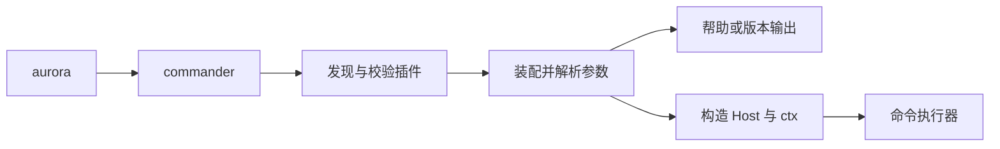

# aurora_cli 技术说明

`aurora_cli` 是 AuroraBot 的命令行宿主，负责命令发现与分派、项目配置、进程环境和终端交互。命令入口为 `aurora`，也支持 `python -m aurora_cli`。

通用组合机制由 `aurora_kernel` 提供，Bot 装配与运行由 `aurora_bot.runtime` 负责。CLI 通过命令执行器调用这些能力；Bot 不依赖 CLI。

## 运行 Playground

在项目根目录启动交互式 Playground：

```bash
uv sync --locked --group dev
uv run python -m playground
```

每行输入一个 JSON 对象；返回退出码、标准输出、错误输出和结构化业务结果：

```json
{"action":"describe","module":"cli"}
{"module":"cli","operation":"execute","input":{"argv":["demo","greet","Aurora"]}}
{"module":"cli","operation":"execute","input":{"argv":["--help"]}}
{"action":"exit"}
```

交互入口使用真实解析和分派，只绑定内存演示命令；不读取个人配置或本机插件。输入与输出 schema、示例可通过 `describe` 查询，完整协议见 [Playground 说明](../../playground/README.md)。

[CLI 场景脚本](../../playground/examples/cli.py)默认运行全部场景，也可单独选择：

```bash
uv run python -m playground.examples.cli commands --name Aurora
uv run python -m playground.examples.cli plugins --name 小极光
uv run python -m playground.examples.cli config --message "你好，Aurora"
uv run python -m playground.examples.cli validation
```

| 场景 | 观察内容 |
| --- | --- |
| `commands` | 命令规格、子命令帮助、选项解析、参数透传与退出码 |
| `plugins` | 内存声明和目录插件发现、帮助输出的构造边界、ctx 注入与独立 Host |
| `config` | 模板初始化、配置编辑、类型化读取、内存值替换与资源补齐 |
| `validation` | 命令重名、依赖缺失、调用点缺失、路径越界和配置目标冲突 |

示例使用真实 CLI 接口，通过显式来源选择演示插件。插件、配置和资源保存在临时目录中，结束后清理；运行无需网络、模型或个人配置。输出中的 `$ aurora ...` 表示脚本使用演示命令目录执行的调用，`demo`、`greet` 和 `local` 在该目录中注册。

脚本在关键边界检查实际结果。预期的参数错误和声明冲突会显示对应提示，异常结果会使脚本失败。可调整脚本中的 `COMMAND`、namespace、配置形状或无效声明，观察真实接口的行为。

## 模块职责

| 模块 | 职责 |
| --- | --- |
| `main.py`、`__main__.py` | 提供进程入口，将参数交给命令分派层 |
| `commander.py` | 选择项目根目录、加载插件目录、分派执行并返回退出码 |
| `parsing.py` | 将命令规格转换为 argparse 解析器，提供中文帮助和顶层参数预解析 |
| `contracts/command.py` | 定义命令规格、执行器绑定和规格结构校验 |
| `contracts/config.py` | 定义配置规格、字段形状和配置集合 |
| `contracts/plugin.py` | 定义插件及其命令、配置、资源贡献 |
| `plugins/discovery.py` | 声明插件来源，复用内核的包、目录和安装入口发现机制 |
| `plugins/catalog.py` | 校验插件声明，建立命令目录并绑定 Host 调用点 |
| `plugins/configs.py` | 管理配置目录、目标路径检查和模板初始化 |
| `plugins/declaration.py` | 提供单命令、单配置插件的声明适配函数 |
| `configurator.py` | 校验配置重名与文件路径重复，调用解析器并装配配置集合 |
| `commands/` | 实现命令及其应用用例 |
| `configs/` | 按配置项提供解析器、TOML 模板和配套资源 |
| `utils/` | 提供环境加载、日志、信号、子进程、TOML 和终端表格等支持 |

命令规格描述输入，执行器处理终端边界，服务编排用例，存储模块负责持久化。参数解析层不加载个人配置，配置装配层不负责终端输出。

## 命令执行



顶层 `--root` 指定项目根目录，默认使用当前工作目录。预解析在命令名处停止，命令自身的同名选项不会改变插件发现目录。宿主将根目录解析为绝对路径，并在执行时注入 `arguments.root`。

`commander.run(argv)` 返回整数退出码，`commander.main(argv)` 将其转换为 `SystemExit`。argparse 的帮助和输入错误仍通过 `SystemExit` 结束解析。调用方可向 `run` 传入 `CommandRegistry`，直接使用显式命令目录；此时不执行默认插件发现，也不提供插件 Host 的参数注入。

参数规则如下：

- 顶层与各级子命令的长选项均要求完整名称。
- 执行器只绑定到叶子命令；未选择叶子时显示当前层级帮助。
- `passthrough` 使用 `argparse.REMAINDER` 保留后续参数；没有自身参数或选项的纯透传叶子直接保留全部输入，包括 `--help`，交给目标程序解释。解析器保留显式 `--` 分隔符，由执行器决定如何处理。
- 独立使用 `--version` 不加载插件；`--help` 会发现并校验插件，但不构造 namespace、不读取个人配置、不创建文件。

插件模块导入必须只声明元数据。发现过程会导入模块，宿主无法阻止模块顶层代码自行产生外部效果。

## 插件协议与生命周期

内置命令、内置配置和外部 CLI 插件统一导出 `MODULE: CliPlugin`。

| 来源 | 声明位置 |
| --- | --- |
| 内置命令 | `aurora_cli.commands.<name>` 包入口 |
| 内置配置 | `aurora_cli.configs.<name>` 包入口 |
| 项目插件 | `extensions/cli/*.py` 或 `extensions/cli/<name>/module.py` |
| 已安装插件 | `aurora_cli_plugin` entry point |

CLI 插件目录与 Bot 的 `extensions/plugins/` 目录承担不同职责。CLI 插件贡献终端命令和配置；Bot 插件贡献运行时能力。

`CliPlugin` 包含一个 `Namespace` 或 `ModuleSpec`，以及命令和配置贡献。`CommandContribution` 将命令规格绑定到调用点，`ConfigContribution` 将配置规格与模板资源关联。

加载器在 namespace 构造前校验内核 API 兼容性、依赖、依赖环、hook 冲突、命令名称、配置名称和目标路径冲突。命令目标必须存在且采用 `single` 模式。内核未选中的模块不贡献命令或配置。

每次默认 CLI 调用建立独立的 `PluginCatalog`；每次通过目录执行命令创建独立的同步 Host 和 ctx。宿主在构造前注入以下对象：

| 访问位置 | 内容 |
| --- | --- |
| `arguments.root` | 本次项目根目录 |
| `arguments.cli` | 本次 `PluginCatalog` |
| `ctx["aurora.cli"]["root"]` | 与执行器相同的项目根目录 |
| `ctx["aurora.cli"]["catalog"]` | 与执行器相同的插件目录 |

CLI 插件的生命周期 hook 仅支持 `CONSTRUCT`。namespace 构造用于建立内存状态，文件、连接和异步任务由命令执行器管理和释放。需要 Bot 生命周期的能力由 Bot 模组承载。

`root`、`cli` 是宿主字段，`executor`、`help_parser` 是解析器元数据，自定义参数的 `dest` 应避免占用这些名称。

## 配置与资源

内置配置的目录结构为：

```text
configs/<name>/
├── __init__.py
├── <name>.py
├── <name>.toml
└── resources/
```

`<name>.py` 定义 `CONFIG_SPEC`，包入口通过 `config_plugin` 导出插件。`ConfigSpec` 使用 `TableShape`、`TableArrayShape` 声明字段映射，或通过 `parse` 指定解析函数。简单配置使用声明式形状，具有跨字段约束的配置使用专用解析器。

`config_plugin` 将同名 TOML 映射到 `ConfigSpec.path`，并将 `resources/` 内文件映射到配置文件去掉扩展名后的目录。例如，`config/prompts.toml` 对应的资源目录是 `config/prompts/`。

### 路径检查与加载

配置和资源目标必须是项目内的相对文件路径。目录检查拒绝父级跳转、绝对路径、盘符、越出项目的符号链接，以及文件与目录之间的路径冲突。

`ConfigCatalog.load(root)` 先检查全部配置目标路径，再调用 `assemble_config`。装配器先校验全部名称和文件路径是否重复，然后依次调用解析器。重复声明不会触发部分配置加载。

`ConfigSpec.load(root)` 是单项解析入口，本身不执行目录的路径检查。插件单独读取配置时，应先调用 `catalog.configs.path(root, name)`；加载全部配置时使用 `catalog.configs.load(root)`。

`AuroraConfig` 保存配置值、来源和项目根目录：

- `get(spec)` 按配置规格读取值。
- `resolve(ConfigType)` 按 DTO 类型读取值；同类型存在多个条目时返回最先装配的值，需要区分条目时使用 `get(spec)`。
- `with_value(spec, value)` 返回替换指定条目后的新集合。

配置集合保护自身映射，配置值的不可变性由对应 DTO 保证。Bot 通过注入的配置契约读取值，不调用 CLI 的发现入口。

### 模板初始化

`ConfigCatalog.missing` 只报告缺失文件。`initialize` 在写入前检查全部选中目标，并读取所有待创建模板；已有个人文件不读取模板、不覆盖。

写入采用独占创建。若目标已被其他调用创建，则跳过该文件。初始化不提供跨文件事务：写入中途出现 I/O 错误时，已经创建的文件会保留，再次调用继续补齐缺失文件。

`aurora config --init` 显式创建个人配置；`aurora start` 在加载前补齐所有入选配置与资源。只读查看命令不初始化配置。

## 命令组织

简单命令可在 `commands/<name>/__init__.py` 中声明规格、执行器与 `MODULE`。复杂命令在同包按职责划分模块，发现器只读取包入口导出的插件。

`app` 命令的职责划分如下：

| 模块 | 职责 |
| --- | --- |
| `__init__.py` | 加载环境、组装服务、分派子命令，将领域错误转换为终端提示和退出码 |
| `spec.py` | 声明命令参数与帮助文本 |
| `installation.py` | 选择安装来源、校验来源参数，统一计划展示、确认、取消和结果输出 |
| `service.py` | 编排查询、安装、启停和移除用例 |
| `install.py`、`manifest.py` | 校验安装输入、解释清单并构造计划 |
| `github.py`、`clone.py`、`verify.py` | 封装仓库查询、Git 克隆和 MCP 检查 |
| `store.py`、`transaction.py` | 管理注册表、文件提交与失败恢复 |
| `render.py`、`models.py` | 提供终端展示和数据模型 |

安装服务接受确认回调，不读取标准输入。CLI 在回调中展示计划并询问用户；`--yes` 只跳过询问，仍展示计划并执行安装检查。三种来源共用终端交互，各自保留来源校验和持久化规则。具体用法见 [App 命令说明](commands/app/README.md)。

`start` 负责项目环境、配置、日志和停止信号，并调用 Bot 运行时；信号处理器在退出时恢复。`setup` 调用工程初始化脚本，`docs` 调用文档站的 pnpm 脚本，`check` 编排代码质量工具与测试。

## 扩展命令

将以下内容保存为 `extensions/cli/hello.py`：

```python
import argparse
import sys

from aurora_cli.plugins import command_plugin


def execute(arguments: argparse.Namespace) -> int:
    sys.stdout.write(f"你好，{arguments.name}！\n")
    return 0


MODULE = command_plugin(
    "example.cli.hello",
    {
        "name": "hello",
        "help": "输出问候",
        "args": {"name": "称呼"},
    },
    execute,
)
```

运行 `aurora hello Aurora`。内置命令使用相同协议，将插件放在 `commands/<name>/` 包中即可参与目录发现。多项贡献与安装入口的声明方式见 [CLI 命令与配置插件](../../apps/docsite/src/develop/cli-plugins.md)。

## 进程边界与验证

`load_project_env` 读取项目 `.env`，保留已有进程环境变量，并设置 LiteLLM 使用本地费用表。环境加载由需要它的命令显式调用。

终端命令使用以下退出码约定：

| 退出码 | 含义 |
| --- | --- |
| `0` | 成功或正常帮助输出 |
| `1` | 一般执行失败 |
| `2` | 配置或输入错误 |
| `130` | 中断或取消 |

包装外部程序的命令可以保留子进程退出码。领域错误由命令边界转换为提示；服务层通过异常报告失败，不负责输出和退出进程。日志不记录 Prompt、消息正文、工具参数或凭据。

在项目根目录执行：

```bash
uv sync --locked --group dev
uv run pytest -q tests/cli
uv run aurora check --fix
```

测试位于 `tests/cli/`，按配置与 App 能力组织。仓库查询、克隆和 MCP 连接使用离线替身，子进程适配器使用本地探针验证，文件操作使用临时目录。重点覆盖插件在构造前的校验、路径边界、配置初始化幂等性、安装确认、事务恢复和退出码。

系统边界见 [系统总览](../../apps/docsite/src/architecture/system-overview.md)，通用组合协议见 [Namespace 与 hook](../../apps/docsite/src/develop/namespace-modules.md)。
